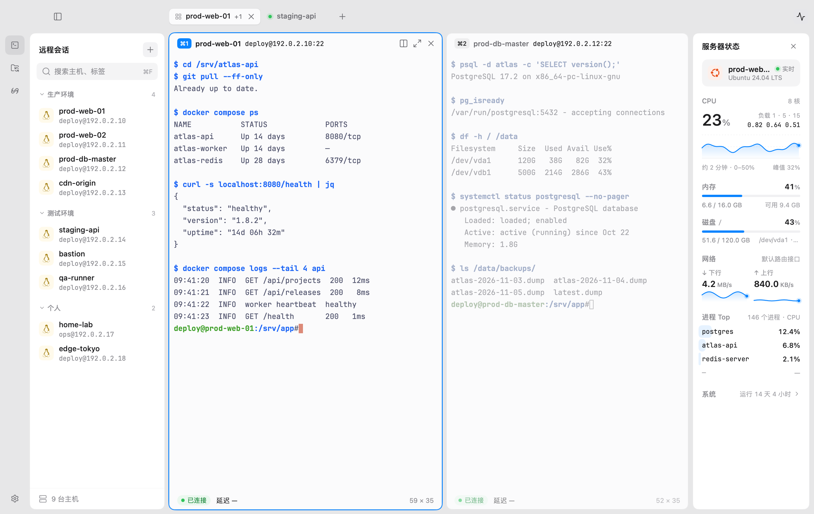
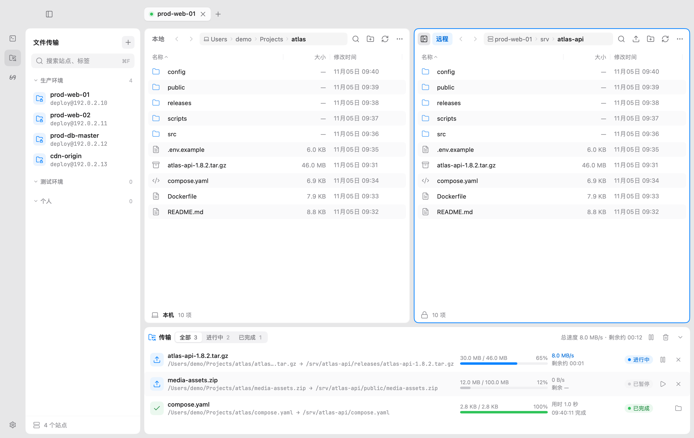
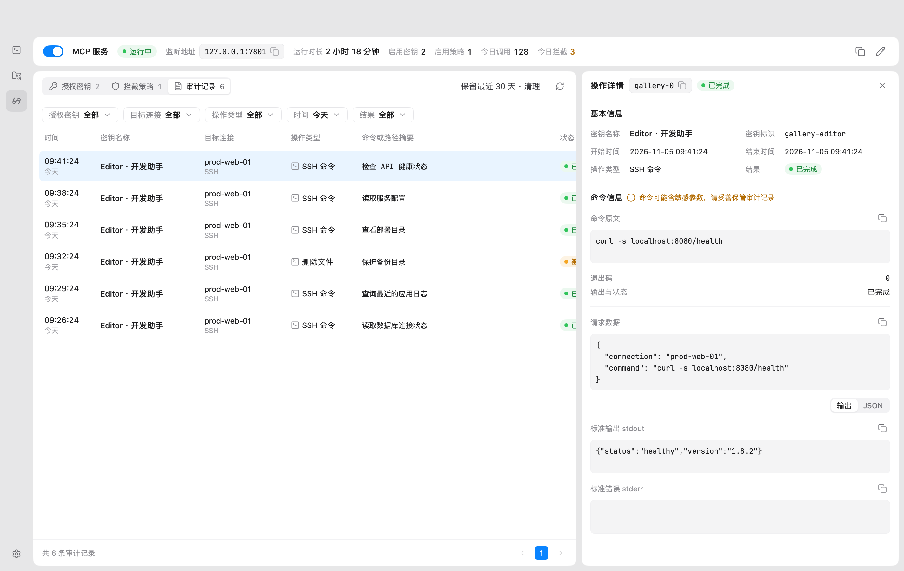

<p align="center">
  
</p>

<h1 align="center">Burrow</h1>

<p align="center"><a href="README.md">English</a> · <a href="README.zh.md">简体中文</a></p>

<p align="center"><strong>Terminals, files, and server status in one native workspace.</strong></p>
<p align="center">An SSH / SFTP / FTP / FTPS desktop app for everyday remote development and operations.</p>

<p align="center">
  <a href="LICENSE"></a>
  
  
</p>

<p align="center">
  <a href="#features">Features</a> ·
  <a href="#screenshots">Screenshots</a> ·
  <a href="#get-started">Get started</a> ·
  <a href="docs/README.md">Documentation</a> ·
  <a href="CONTRIBUTING.md">Contributing</a>
</p>

<picture>
  <source media="(prefers-color-scheme: dark)" srcset="docs/screenshots/readme/ssh-dark.png">
  <source media="(prefers-color-scheme: light)" srcset="docs/screenshots/readme/ssh-light.png">
  
</picture>

<p align="center"><sub>Organize connections, work in terminals side by side, and inspect the current host.</sub></p>

## Features

- **SSH workspace**: tabs, grouped splits, movable and maximizable panes. Splits in one session share an SSH connection while each Shell runs independently. Supports passwords, plain and encrypted private keys, and SSH agent.
- **Connection gateways**: manage SSH / SOCKS5 / [WireGuard](docs/wireguard.md) exits and multihop routes for terminals, file transfers, and MCP. Set an app default or choose a gateway per connection.
- **Two-pane file management**: browse and transfer between local and remote directories over SFTP, FTP, and explicit or implicit FTPS. Search, create, rename, delete, and resolve name conflicts.
- **Transfer queue**: upload and download files or directories with concurrency, pause, resume, cancellation, and retry. Tasks are isolated by file tab and can be restored offline after quitting.
- **Server status**: inspect Linux CPU, memory, network, processes, and host information. Root disk capacity is available when the server provides the required SFTP capabilities.
- **Local MCP service**: expose authorized SSH and file operations to trusted clients over Streamable HTTP, with access keys, connection and capability grants, interception policies, operation auditing, and a live read-only view of each agent's commands and output.
- **English and Chinese UI**: choose English, Simplified Chinese, or the system language. App-owned menus, dialogs, queued notifications, and accessibility labels follow language changes; dates and times use the app language and system regional formats. User content and remote output retain their original text.
- **Personal settings**: light and dark appearance, terminal colors, fonts, cursor, and shortcuts. Vault encrypts passwords, managed private keys, and saved key passphrases.

Built in Go with [MyGo](https://github.com/egoist/mygo), with a terminal powered by [Ghostty VT](https://github.com/ghostty-org/ghostty).

## Screenshots

These screenshots use the app's native UI with fictional hosts, files, metrics, and tasks. They demonstrate the interface only. The SSH image follows the GitHub page theme. Current images show the Chinese UI; they do not establish English layout acceptance. See the [screenshot notes](docs/screenshots/readme/README.md) for sources and reproduction steps.

### File management and transfers

Browse local and remote directories side by side, with transfer progress and status in one queue.



### MCP authorization and auditing

Let trusted clients use saved connections and review operations, results, and policy interceptions in the app.



## Get started

Burrow is a **0.x developer preview**. Packages and release notes are available on [GitHub Releases](https://github.com/zeroy1024/Burrow/releases). You can also run it from source.

| Platform | Current status |
|---|---|
| macOS Apple Silicon | Primary development platform; macOS 13+; APP / DMG / ZIP build entry points |
| Windows x64 / ARM64 | Cross-compilation and installer builds are integrated; native startup, installation, upgrades, and uninstallation await acceptance |
| macOS Intel / Linux | Build targets are retained; runtime and desktop integration are not fully verified |

See [platform support](docs/platform-support.md) for the validation scope. Current macOS releases use self-signing and are not notarized by Apple; see [signing and unlock](docs/macos-signing.md).

### Run from source

Install [mise](https://mise.jdx.dev/), then run from the repository root:

```sh
mise install
mise exec -- go run .
```

The first run may download native terminal libraries. Development builds use a separate data directory. Create an SSH session, choose **Save and Connect**, and verify the host fingerprint on the first connection. See [first steps](docs/getting-started.md).

### Development and packaging

`mise.toml` pins the toolchain. See [development and builds](docs/development.md) for tests, cross-compilation, release signing, and `mise run build`. Full macOS packaging requires the release signing identity; ordinary development can use the source command above.

GitHub Actions checks branches and PRs for sensitive data, licenses, language resources, existing tests, and cross-platform builds. A `v*` tag matching the project version triggers Windows builds for both architectures and macOS ARM64 packaging. Outputs are stored as Actions artifacts; workflows do not automatically create a Release. Existing Gitea workflows are retained.

## Data and connections

- Passwords, managed private keys, and saved passphrases are encrypted in SQLite. The macOS release build keeps its automatic unlock key in the system Keychain; other builds use a local key file. Optional app password unlock is available. Connection addresses, paths, audit records, and other database metadata are not encrypted as a whole.
- Deleting a saved host or site closes its associated saved sessions. Remote file operations are performed separately on the file page.
- Workspace and transfer restoration stays offline. It does not log in or resume transfers automatically. Forced termination or power loss may lose the latest progress.
- MCP can execute remote commands and read or write files within its grants. Give keys only to trusted clients. Commands and output may contain sensitive data; redact diagnostic material before sharing it.

See [data and credentials](docs/storage.md), the [MCP design and contract](docs/mcp-server-plan.md), and [known limitations](docs/limitations.md). Report vulnerabilities privately using [SECURITY.md](SECURITY.md).

## Documentation and contributing

| Using the app | Development |
|---|---|
| [First steps](docs/getting-started.md) | [Contributing](CONTRIBUTING.md) |
| [Sessions and settings](docs/session-settings.md) | [Development and builds](docs/development.md) |
| [File management and transfers](docs/file-transfer.md) | [Architecture and lifecycle](docs/architecture.md) |
| [Terminal and color schemes](docs/terminal-themes.md) | [Themes and design tokens](docs/theme-integration.md) |
| [Server monitoring](docs/monitoring.md) | [Protocol and native integration](dev/ssh-integration/README.md) |
| [Interface languages](docs/i18n.md) | [Language resource maintenance](docs/i18n.md#resources-and-generation) |

See the [documentation index](docs/README.md) for more. Use [Issues](https://github.com/zeroy1024/Burrow/issues) to report problems or discuss suggestions, and read the contribution guide before opening a PR.

## License

Burrow's own code is licensed under [MIT](LICENSE). Third-party code, native libraries, fonts, icons, and color schemes retain their own licenses. Full texts are in [third-party notices](THIRD_PARTY_NOTICES.md) and ship with the native app.
