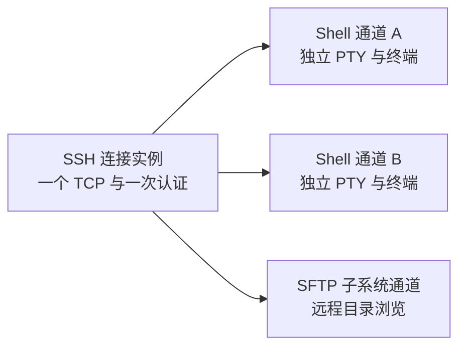

# SSH 与文件功能独立及连接复用方案

日期：2026-11-01。状态：基础实现已落地；目录隔离、共享连接、协议 SDK 及文件原生窗口联调已通过；三个 Shell 同时创建的原生用例也已验证单 TCP / 单次认证和退出清理。

本阶段已将 SSH 主机目录与文件站点目录分开，并让同一运行会话的 SSH 分屏、SSH 与 SFTP 快捷跳转复用已认证连接。保存配置、网络连接和界面视图分别管理，避免目录互相污染，也避免关闭一个窗格时断开其他业务。

本方案采用的“复用会话”语义是：共享底层 SSH 连接与认证，各终端窗格仍有独立 Shell、PTY 和屏幕；快捷跳转优先激活已有目标视图。两个窗格镜像同一个 Shell 的输入输出不属于本方案。

## 需求与基础阶段范围

| 场景 | 目标行为 |
| --- | --- |
| 在 SSH 添加、编辑、排序或删除主机 | 仅影响 SSH 目录 |
| 在文件页添加、编辑、排序或删除 SFTP / FTP 站点 | 仅影响文件目录 |
| SSH 同会话分屏 | 在同一已认证连接上新开 Shell 通道，不重新拨号或认证 |
| SSH 与 SFTP 快捷跳转 | 激活已有目标；没有目标时，在源连接上创建对应通道和临时视图 |
| 普通 FTP 与 SSH 快捷跳转 | 根据显式关联激活目标会话；目标未连接时，按目标协议独立登录 |
| 快捷跳转产生的临时视图 | 不自动加入对方保存目录 |
| 关闭一个窗格或文件标签 | 仅结束自身业务通道；其他消费者继续使用连接 |

基础阶段包括目录独立、连接复用、快捷跳转、SFTP / FTP 登录与远程目录只读浏览、取消 / 断开 / 重连及 Docker 联调。密码与私钥口令继续按需输入。钥匙串、真实上传下载、写文件操作、队列和新版视觉交互在后续阶段补充。

## 改造前问题与对应位置

| 改造前实现 | 原有影响 | 对应位置 |
| --- | --- | --- |
| `app.hosts/groups` 与 `catalog.json` 只有一套目录 | 两页的新增、编辑和删除实际作用于同一数据 | `internal/desktop/app.go`、`catalog_config.go` |
| `hostID` 是数组下标，删除后重编号 | 不能作为长期快捷关联或运行身份 | `catalog_config.go`、`ftp_sessions.go` |
| `splitSession` 调用 `newSession → connectSession → Dial` | 每个新窗格都会重新建立 TCP 并认证 | `model.go`、`ssh_sessions.go` |
| `sshclient.Dial` 同时完成网络连接、认证、PTY 和 Shell | 连接与单个 Shell 生命周期绑在一起 | `internal/sshclient/client.go` |
| Shell 结束、输入 / resize 失败和 `Conn.Close` 都可能关闭整个 `ssh.Client` | 直接共享当前 `Conn` 会互相断开 | `internal/sshclient/client.go` |
| 删除文件站点会关闭对应 SSH 窗格 | 违反功能独立要求 | `ftp_sessions.go` 的 `deleteFileSite` |
| 切换到文件页会自动打开第一个主机 | 接入真实协议后会产生隐式网络连接 | `app.go` 的 `switchSection` |
| 文件本地路径偏好按 `user@address:port` 保存 | 同地址的不同文件站点会串用偏好 | `ftp_config.go` 的 `fileSiteKey` |
| 会话标题从当前目录条目读取身份 | 修改目录后，标题可能显示新地址，实际连接仍指向旧地址 | `terminal.go`、`ftp_sessions.go` |

上述表格描述改造前状态。本阶段已调整数据归属与连接所有权，并通过独立适配包接入真实文件协议。

## 目录与运行身份

### 两套独立目录

当前继续使用 `catalog.json`，格式升级为 v2；JSON 的 `ssh` / `files` 分别对应运行时的 `sshCatalog` / `fileCatalog`。两者的条目、分组、排序和折叠各自维护；目录控件共用渲染实现，显式接收当前目录。两个目录沿用一次原子写入和失败回滚。

每个目录维护稳定整数 ID、分组 ID，以及持久化的 `next_host_id` / `next_group_id` 计数，删除后不重编号、不复用。身份由目录作用域与 ID 共同确定，两个目录的相同整数 ID 代表不同记录；同名、同地址条目也不会自动关联。

保存记录与运行会话分离：

- 保存记录描述以后如何连接，不持有 socket、Shell 或文件客户端。
- 运行会话保存建立连接时的端点和认证来源快照。编辑目录不改变已打开连接的身份或标题。
- 删除目录条目时保留已打开的运行会话及其快照，直到用户明确关闭。删除一侧记录不会删除另一侧记录或断开另一侧消费者。
- 快捷关联指向运行视图及连接快照；删除保存记录不会切断已关联运行视图，也不会按同名或同地址替换目标。关闭后从目录重新打开才采用当前保存配置。

### 旧数据迁移

旧配置没有“创建于哪个功能”的字段，`protocol` 也不能可靠还原创建来源。首次迁移把原有目录复制为两套独立副本，保留现有可见数据；此后任何修改均不再传播。成功后显示一次迁移说明，告知旧条目已分别保留，后续修改互不影响。

SSH 分组沿用旧 `collapsed`，文件分组沿用旧 `files_collapsed`；迁移保留旧数值 ID，分别归入两个独立命名空间和后续 ID 计数，不自动生成永久快捷关联。

旧 `files.json` 的站点本地路径按地址键一次性映射到新 `FileSiteID`。这部分站点偏好随目录迁移导入 v2 的文件站点偏好区；`files.json` 继续保留全局布局偏好。这样迁移提交只需原子替换 `catalog.json`，不必跨两个配置文件提交。旧地址键原来已有碰撞时，只能保留当前存储的值，不能推断丢失的历史。

迁移前创建 `catalog.json.v1.bak`，存在的旧文件偏好备份为 `files.json.v1.bak`；原 `files.json` 不在迁移中覆写。v2 写入成功后不重复复制，失败时保留旧数据并阻止覆盖。

## SSH 连接与业务通道

SSH 支持在一个已认证连接上打开多个独立通道。当前固定依赖的 `ssh.Client.NewSession()` 调用 `OpenChannel("session")`，不重新拨号；`ssh.Session.Close()` 关闭的是该通道。[协议依据：RFC 4254](https://www.rfc-editor.org/rfc/rfc4254.html#section-5)。

当前沿用现有 Go 包组织，`internal/sshclient` 分开管理连接与通道，`internal/fileclient` 提供 SFTP / FTP 只读适配：

| 对象 | 责任 |
| --- | --- |
| `sshConnectionGroup` | 桌面层的连接实例 ID、身份快照、generation、认证等待者与通道请求顺序 |
| `sshclient.Connection` | 已认证传输、消费者引用、在途通道创建与后台资源清理 |
| `sshclient.Conn / Stream` | 独立 Shell / 子系统通道、PTY、输入输出和尺寸；关闭时释放自身引用 |
| `fileclient.Client` | 目录只读接口；SFTP 在指定 SSH 连接上申请子系统，FTP 独立登录和读取被动目录 |
| SSH 窗格 / 文件标签 | 持有业务 handle 和显示状态，不直接决定共享 TCP 的生命周期 |

接口语义收口为：连接认证、在指定连接上打开 Shell、在指定连接上打开 SFTP、关闭子 handle、关闭连接。认证配置与 PTY 参数分离，协议包不依赖 MyGo 控件。

### 分屏规则

分屏继承来源窗格的 `ConnectionID`，再打开新的 Shell 通道。各窗格的命令、环境变量、工作目录、尺寸和 Ghostty 屏幕独立；复用连接不会继承另一 Shell 里执行过的 `cd` 或变量赋值。

标签和分屏树只是布局容器。不同主机的窗格可以在同一标签内；拖动已有窗格保留其连接归属，不重新连接。显式新建顶层 SSH 会话仍允许建立独立连接，本阶段不按地址或用户名建立全局自动连接池。

### 生命周期与重连

- 连接上下文由连接实例持有，不再使用第一个窗格的上下文作为共享连接的寿命。
- 活动通道和仍有结果接收者的待创建请求计入所有权；取消立即释放该请求的保活引用。未完成 worker 继续由连接实例跟踪，但不再计入保活；有效引用归零即关闭底层连接，使挂起 worker 解除等待并收敛。取消、关闭与释放必须幂等，网络清理不持状态锁。
- Shell 正常退出、关闭窗格、断开当前 Shell 或关闭文件标签，仅结束对应通道并释放引用。显示历史不需要继续占用网络连接。
- 最后一个活动或待创建消费者结束时，关闭 TCP。SFTP 仍打开时，关闭全部 SSH 窗格不会断开 SFTP，反向同理。
- Shell / SFTP 子通道被拒绝、单通道输入或 resize 失败，先按该业务通道处理；底层连接故障才统一通知同一连接实例的所有消费者。
- 底层仍健康时，重新连接一个已结束的 Shell 只开新通道，无需重新认证。
- 底层已失效时，第一次显式重连为原连接组建立一次新传输并提升 generation；并发请求等待同一次认证。本阶段只恢复主动请求的通道，其余视图保持断开，后续请求复用新传输。不增加后台自动重试或批量恢复。
- 旧 generation、已关闭视图和已取消请求的异步结果不得覆盖新状态。新 Shell 是新进程，终端历史可以保留，原进程状态不会自动恢复。

## 快捷跳转

### SSH 与 SFTP

1. 从当前运行视图传递明确的 `ConnectionID` 和来源视图引用。
2. 目标视图仍存在时，直接激活，保留其当前目录、历史或终端输出。
3. 没有目标视图时，在同一 SSH 连接上打开 Shell 或 SFTP 子通道，创建临时目标标签。
4. 多个分屏通过快捷按钮进入文件页时，可复用该连接对应的文件视图；返回时优先回到最近来源窗格，其次选择同连接的存活窗格，再按需新开 Shell。
5. 临时目标不会进入保存目录。需要保存配置时在对应目录独立添加；临时视图的直接另存交互留给后续 UI 对接。

独立打开的 SFTP 站点也先建立自己的 SSH 连接，因此可以通过同样规则打开 Shell。SFTP 专用账号可能只允许文件子系统；此时目标 Shell 显示不支持或权限错误，原 SFTP 会话继续工作。[SFTP 子系统依据](https://man.openbsd.org/sftp-server)。

快捷跳转不自动同步 Shell 当前目录和文件页目录。复用依据是具体连接实例，不能仅凭地址、用户名或同名配置合并；显式关联的目标若使用不同端点或身份，应按目标配置独立连接。

### 普通 FTP 与 SSH

普通 FTP 使用自身的控制连接和数据连接，不能当成 SSH 的子通道，也不能沿用 SSH 认证结果。[FTP 协议模型](https://www.rfc-editor.org/rfc/rfc959.html#section-2.3)。

当前实现为运行期显式关联：从 FTP 的快捷入口首次选择已有 SSH 主机，再关联对应运行视图；已有匹配视图就激活，没有时按所选 SSH 配置连接。之后该运行会话的两个按钮可双向跳转，断开的目标在显式快捷打开时可以重连。关联不写入保存目录，也没有实现永久默认快捷目标配置。

不能静默把 FTP 的 21 端口改成 SSH 的 22，也不能假定 FTP 用户是 SSH 登录用户。源 SSH 的临时密码不得自动提交给 FTP。没有关联目标时，应引导选择目标，不猜测服务器能力。

因此“一键跳转并复用”在 SSH 与 SFTP 间可以同时覆盖连接和视图；普通 FTP 场景复用已有目标会话，首次目标登录仍可能需要凭据。这是基础实现的协议边界。

## 文件基础连接与 UI 对接

SFTP 已使用 `github.com/pkg/sftp v1.13.12` 接入 SSH 子系统，复用认证与主机密钥校验；FTP 使用 `github.com/jlaffaye/ftp v0.2.4` 独立实现登录、被动数据连接、目录读取及错误反馈。同一 FTP 会话的命令顺序执行，目录读取结束后释放该次数据连接，不建立 SSH 与 FTP 的通用网络连接池。

基础能力限于真实连接、列目录、进入目录、返回上级、刷新和取消 / 断开 / 重连。真实目录已取代演示目录，模拟传输进度退出真实流程；上传、下载、改名、删除、传输队列及本地文件操作入口禁用或明确提示未开放，不生成假成功。

文件页仅在用户明确打开站点或点击快捷按钮时连接，移除切页自动打开第一个站点的行为。目录只读结果按对应运行会话绑定；迟到响应不能覆盖已切换目录或已关闭标签。

新版 UI 通过稳定目录 ID、运行视图 ID、连接 ID 和打开 / 激活接口对接。协议包、连接所有权和迁移逻辑不依赖按钮坐标、布局树或拖动动画。

## 风险与验收边界

| 已确认的约束 | 处理方向 |
| --- | --- |
| 多个通道共用传输，一次网络断开会影响同组消费者 | 将故障作为共享连接事件分发，保持各视图状态一致 |
| 服务端可能限制并发通道数或禁止 SFTP / Shell | 只让目标操作失败；不偷偷另建 TCP 来绕过复用要求 |
| `NewSession / OpenChannel` 没有逐请求 context，可能等待服务端答复 | 取消时立即撤销界面绑定，迟到通道关闭；不能用共享 socket deadline 或关闭共享 TCP 来取消单个窗格 |
| 服务端永不答复通道创建请求 | 每条连接至多保留一个在途通道创建；已取消但未答复的创建仍占该名额，期间不继续启动新的创建 goroutine，并明确提示等待或显式重建共享连接。最后消费者离开时关闭连接，使内部等待收敛 |
| 旧目录无法判定原始归属 | 一次性复制保留历史，后续完全独立；迁移失败保护原数据 |
| 新版 UI 会触及同一批 desktop 文件 | 将协议包、数据模型和最小界面适配分步交付，避免把视觉重做混入连接改造 |

SFTP 适配使用所属子通道的流关闭和初始化保护，相关共享生命周期与取消场景已通过 SDK 联调。SFTP 初始化和目录读取各有 20 秒边界；FTP 建连与登录整体、PWD、单次 CWD + LIST 分别受 20 秒边界约束。SSH TCP 建连仍为 20 秒，握手与认证仍为 2 分钟。普通 FTP 的凭据与数据为明文；当前 FTP 库会略过无法解析的 LIST 行，因此基础实现不承诺所有服务器目录格式完整显示。

## 实施进度与验收

1. 已实现：SSH 连接 / 通道所有权拆分与同会话分屏复用，基础原生窗口验证通过。
2. 已实现：v2 独立目录、稳定 ID、运行快照与旧目录迁移；相关竞态测试及基础原生隔离验证通过。
3. 已实现：SFTP 真实连接与目录只读浏览，共享连接、独立关闭和取消的 SDK 联调通过；真实文件界面联调通过。
4. 已实现：FTP 独立登录、被动目录读取和协议错误处理，SDK 联调通过；真实文件界面联调通过。
5. 已实现：SSH / 文件快捷跳转与临时视图，FTP 当前运行会话的显式目标选择；双向原生跳转联调通过。

密码保存、文件写入、传输增强与永久快捷目标配置继续后置，本阶段不合并新版 UI。当前状态不代表上传下载、本地文件访问或新视觉交互已经实现。

验收重点：

- 新增、编辑、排序、删除任一目录记录均不改变另一目录；快捷跳转不会增加对方保存记录。
- 迁移后两份历史副本可独立修改，失败或再次启动不会丢数据或重复导入。
- 同一 SSH 连接从一个窗格分成多个窗格，服务端 TCP 连接数和认证次数保持不变；输入、变量和尺寸仍独立。
- SSH 与 SFTP 双向跳转重复点击只激活目标；关闭任一侧不会断开另一侧。
- 正常 Shell 退出、通道拒绝、通道创建取消及并发打开均不误伤其他健康消费者；最后消费者关闭后无遗留连接。
- 普通 FTP 快捷跳转复用已关联目标会话，不冒用 SSH 凭据或猜测端口。
- 共享连接失效和显式重连期间只认证一次，旧回调不会复活已关闭视图。
- Docker 使用真实 SFTP 子系统、权限受限目录与 FTP 被动端口映射；子通道拒绝、挂起与取消通过受控 SSH / 流测试验证。服务器连接统计、认证日志、远端 `stty`、目录结果及竞态检测用于验证各项可观察行为。原生驱动按新行为断言分屏不再认证，并进一步验证并发分屏与文件协议界面。

验证范围与限制见 [文件连接实现说明](file-transfer.md)，环境与复验步骤见 [Docker 联调说明](../dev/ssh-integration/README.md)。并发三通道创建、文件页核心操作与双向跳转的原生用例已通过，未开展视觉验收。
