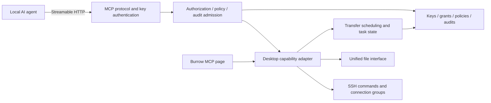

# MCP server design

[English](mcp-server-plan.md) | [简体中文](mcp-server-plan.zh.md)

Interface languages: related pages, forms, notifications, and business errors support English, Simplified Chinese, and System. Protocol fields, state codes, authorization decisions, and persisted values remain stable. Historical free text and raw diagnostics are not rewritten. See [interface languages](i18n.md).

Date: 2026-11-03. Status: backend integrated, originally preserving page layout/styles/components while replacing data sources and callbacks. Authentication, grants, policies, audits, and task identities use existing `burrow.db`. Temporary SQL checks, official Go SDK local HTTP smoke checks, and 30 real MCP → native desktop → SSH/SFTP/FTP/explicit and implicit FTPS E2E scenarios passed on macOS, including service transitions and manual recovery after normal quit/forced crash. Windows had build checks only. See section 14 and [MCP integration](../dev/mcp-integration/README.md) for historical validation boundaries. This page retains the complete product contract for further acceptance.

## 1. Goals and scope

Burrow exposes controlled SSH command and SFTP/FTP/FTPS file capabilities to local AI agents. Users manage authorized connections, access keys, permissions, interception policies, and audits. Agents can inspect servers, read configurations, edit files, and transfer data only through granted, unblocked capabilities.

Confirmed product decisions:

| Item | Contract |
|---|---|
| Runtime | MCP runs with Burrow and accepts local agents |
| Navigation | A separate MCP page beside SSH/File Transfer in the left rail |
| Authentication | Verify the access key on every HTTP request before MCP access |
| Identity | Stable `key_id` owns connection/capability grants, tasks, and audits |
| Policies | Separate command/file policies; granted operations still obey them and any applicable denial blocks |
| Connections | Saved, explicitly authorized entries only in version one |
| SSH | Single commands without PTY, using connection groups independent of user terminals |
| Files | Unified SFTP/FTP/FTPS interface reusing protocol/transfer mechanisms |
| Audit | Commands, paths, process, and results, with per-file traceability for directories |
| Background tasks | Accepted transfers survive client disconnect; revocation blocks new calls and converges owned tasks |
| Ownership | Clients discover authorized connections and, by default, inspect/cancel only their key's tasks |

Version one comprises the page, service control, keys/grants, policies, audits, read-only file tools, single SSH execution, text writes, uploads/downloads, and task management. Read capability first establishes the full admission path; execution/writes complete the same release.

Later extensions may add mkdir, rename, move, delete, long-command tasks, interactive Shell, or stdio bridging. Policies define future action types without presenting unavailable tools as callable. Version one excludes public/LAN access, independent daemons, arbitrary dynamic targets, existing-terminal input control, multiuser management, and centralized remote audits.

## 2. User flow

1. Open MCP, enable the service, and inspect its local address.
2. Create a named access key with connection/capability grants and local upload/download directories.
3. Optionally create command/file interception policies with connection/key scope and denial rules.
4. Copy the newly generated key and configure a client using the template.
5. The client authenticates, discovers tools/connections, and calls stable `connection_id` values.
6. Burrow validates identity, grants, and parameters, persists the start record, verifies required paths/policies, then executes allowed actions. Interceptions are recorded and returned.
7. Short calls return results; background transfers return task IDs for progress/cancellation.
8. Filter audits by key, connection, action, time, and result, and inspect policy hits, per-file details, and associated tasks.
9. Disabling/revoking a key immediately blocks later calls and handles queued/running work under lifecycle rules, retaining history.

Viewing MCP, switching pages, or copying configuration never connects remotely by itself. Passwords, passphrases, unknown-host trust, and interactive authentication remain user interactions in Burrow, not responsibilities delegated to agents.

## 3. Dedicated MCP page

### Navigation and layout

Place the MCP icon after File Transfer and before bottom Settings, reusing Rail selection, tips, and keyboard focus. It is a business page, not a Settings category or SSH/file catalog sidebar.

The page contains a service area and three tabs: Access keys, Interception policies, and Audit log. UI consistently calls Secret Keys access keys.

| Area | Contents |
|---|---|
| Service | Switch, running/fault state, address, copy-config/edit-host-port icons, and actual backend errors |
| Access keys | Name, public prefix/short ID, state, creation/last-use times, grants; create/edit/disable/enable/revoke |
| Policies | SSH/file categories, name, state, connection/key scope, rule summary; create/edit/toggle/hit audits/delete |
| Audits | Key/connection/action/time/result filters, pagination, policy versions, details, files, and tasks |

Display full keys only at creation with explicit copy. After closing, plaintext is unavailable. Templates use placeholders or client-supported environment references; recopying configuration does not justify persisting plaintext keys.

Create/edit key modals show name, connection grants, then directory grants. The matrix exposes supported file-read/file-write/command capabilities, all off by default. Directory sections separate upload sources and download destinations. Successful creation switches to a one-time key view that requires saved-key acknowledgement before closure. Validation/save errors retain input and show reasons.

Key names in lists, audits, and details are plain text without avatars or initials badges.

Audit details show actual associated-task progress/status and state-appropriate cancel/pause/manual-resume actions. Tasks require no file tab to create/query/manage. There is no separate task tab in version one.

Policy editing distinguishes a key's allowed capabilities from denied actions. File rules configure path, side, file/directory kind, subdirectories, and blocked actions per row. Future rename/move/delete tools are marked as taking effect only when available, never implied to exist now.

Create/edit policies use shared modals while the policy table stays full width. Long forms scroll above fixed Cancel/Save actions. Errors retain input; success closes. Right drawers are for audits/tasks.

Clicking a policy row selects only. Edit is available from the context menu or row More button, not row click.

Key menus contain Edit Key, Disable/Enable Key, then Revoke Key. Policy menus contain Edit Policy, Disable/Enable Policy, View matching audit records, then Delete Policy. Deletion uses danger styling/confirmation, stops future policy evaluation, and retains historical hits/rule snapshots.

All main tabs show `0` through `99+` counts. Drag the audit separator to resize details. Connection/key scopes use tagged multiselects: empty means all matching current/future entries; selected means only those IDs. Tag X removes selections; selected dropdown rows use trailing checkmarks.

Opening details preserves filters/pagination. Narrow tables scroll rows, filters, and headers together horizontally. Commands, requests, responses, and stdout/stderr use bounded read-only blocks with selection/full copy. Missing, truncated, and not-yet-recorded contents are distinct. Unknown exit codes are never zero-filled.

Reuse UIKit and semantic themes for light/dark and existing interaction. Page mounting must not own network execution, listeners, tasks, or databases.

### Page-switching constraints

Before adding MCP, some routing treated every non-Settings page as an SSH/file workspace. Catalog frames/drag, session dialogs, sidebar resizing, layout, and focus restoration require explicit page scope; adding an icon/enum is insufficient.

Switching MCP pages must not affect terminals, browsing, or transfers. Leaving MCP or hiding the window must not stop the service/tasks.

## 4. Transport and protocol

### Transport

Version one uses local Streamable HTTP at one `/mcp` endpoint, such as `http://127.0.0.1:<port>/mcp`. It starts disabled, runs with the app when enabled, and honors saved enabled state on later launches. UI always shows actual state.

- Default Host is `127.0.0.1`, Port `7801`, initially off. Existing listener modals edit both. IPv4, IPv6, and hostnames must resolve to local loopback. Report actual bind errors.
- Validate Origin and target host, rejecting invalid sources without permissive browser CORS.
- Verify keys per request; session IDs, kept connections, and client-reported names are not credentials.
- Port conflicts/bind failures do not appear as running or silently choose another port.
- Keys are accepted only in authentication headers, never query parameters.

```http
Authorization: Bearer <secretkey>
```

Official MCP Go SDK `v1.8.0` handles protocol/tool registration, stateless Streamable HTTP, and JSON responses. Each request's header supplies identity. SDK handles negotiation, encoding, and transport cancellation.

Locally provisioned Bearer keys are this release's authentication mechanism, not a complete OAuth implementation. Initial clients must support this transport/header configuration. Remote access and OAuth servers require separate designs.

### Identity and discovery

Before authentication, return no saved connections, tasks, or execution data. Afterward, discovery reflects service capabilities/key grants. Every call still runs server authorization; list visibility is not an access check.

Client-reported names/versions are informational and cannot alter `key_id`, grants, or ownership. Prefer one key per client/agent. Shared keys are one identity for authorization/audits, not reliable attribution to individual users.

## 5. Access key management

### Data and generation

Each key has:

| Field | Meaning |
|---|---|
| `key_id` | Stable, nonreusable public identity |
| `name` | Editable user purpose/name |
| `secret_digest` | Verification digest, not full plaintext |
| `display_prefix` | Nonsecret display prefix/short ID, not authentication |
| `state` | `active`, `disabled`, or `revoked` |
| `created_at` / `last_used_at` | Creation and latest successfully authenticated use |
| `grants` | Connections, capabilities, local directory scope |

Generate keys with cryptographic randomness and at least 256 secret bits. Do not accept low-entropy user passwords as keys. SHA-256 digests are suitable for these random keys; use appropriate constant-time comparison. Public indices alone cannot authenticate.

Show full keys only at creation. Never place them in ordinary settings, debug logs, audits, errors, or exported templates. Lost keys are replaced by new keys and revocation, not plaintext recovery.

### State changes

- `active`: operations allowed within grants.
- `disabled`: temporary, re-enableable; no authentication/tools while disabled.
- `revoked`: permanent; create a new key to continue.

Disable/revoke immediately blocks new requests, cancels queued tasks, and requests cancellation of that key's running operations. Re-enabling does not restart cancelled/paused tasks automatically.

If state/grant reductions cannot persist, block new business execution, stop MCP, converge affected tasks, and explicitly report unsaved changes. In-memory disable must not appear as durable revocation. Reopen only after storage/state verification.

Revocation retains identity records; deleting keys and cascading audits is not offered. Historical operations retain the name at execution plus stable ID; renaming does not change ownership.

Creation, rename, state, revocation, and grant changes are local-user management events, never impersonated agent operations from the affected key.

## 6. Authorization model

### Granularity

Grants are **key × saved connection × capability**, with nothing granted by default. Policies add denial constraints after authorization. Execution requires grants, valid paths/protocol capabilities, and no applicable enabled denial. Policies cannot grant absent capabilities.

| Capability | Operations |
|---|---|
| `files.read` | Listing, metadata, text reads; downloads also require local destination grants |
| `files.write` | Text writes/uploads; uploads also require local source grants |
| `ssh.exec` | One command on the specified SSH connection |

SSH hosts can independently receive all three capabilities, initially off. SSH file work uses that configuration's SFTP subsystem without a separate site. Missing SFTP reports a file-connection error without disabling execution. Separate SFTP/FTP/FTPS sites expose files only. Policy/audit categories follow actual tools: `files.*` over SSH still uses file policies/local directory grants.

Task discovery/query/cancellation requires a valid key owning the task; knowing an ID is insufficient. The local Burrow user can manage all keys' tasks. Version one has no global audit-read tool.

Explicitly grant local upload sources and download destinations separately, without opening the whole local filesystem or equating remote permissions with local rights. Validate actual access using fixed directory handles/constrained resolution, not string prefixes alone.

Remote boundaries start with granted connections and remote account permissions, then file denial rules. Client-side prefixes do not promise an FTP/SFTP sandbox. Recursion retains existing no-symlink-following rules. The policy section defines verification and indeterminate paths.

`ssh.exec` grants the remote account's command capabilities. File-tool directory rules cannot restrict arbitrary commands or reliably infer read-only commands from keywords. Strict isolation requires restricted remote accounts/system permissions. No new per-command approval mechanism is added. Existing trust/credential prompts remain.

### Connection and grant snapshots

`connection_id` is a saved entry's stable ID, never a row index, display name, address match, or open-tab position. Matching SSH/file addresses do not automatically share grants.

Equivalent SSH/SFTP configurations merge into one authorization/default-discovery row, preferring the SSH ID. Merge only when address, port, account, authentication source, complete gateway route, and filename encoding match. Independently saved passwords are verified in memory only when available; password fingerprints are neither stored nor returned. FTP/FTPS stays separate.

Merging does not change existing grants. Original SFTP IDs remain valid. Old SFTP permissions through a merged row still use original SFTP configuration, identity, policies, and ownership, without execution or other additional rights. Editing retains each source's permissions. Turning a capability off removes it from all row sources; explicitly enabling a new capability binds only the displayed SSH configuration. New keys start entirely off. Protocol-filtered discovery preserves original IDs.

File policies can select SSH connections. Saving a merged entry records current member IDs so later display separation does not lose restrictions. Ordinary saving of a legacy SFTP-only policy does not expand it to the merged row. Operations check policies applicable to both actual source and merged entry; tasks retain their admitted policy entry for recovery checks.

Grants bind endpoint identity: protocol, address, port, account, applicable authentication source, and jump chain. Identity changes suspend grants until reconfirmed; display-name changes do not.

Key editing unchecks/marks obsolete endpoint grants. Only explicit reselection and save binds current identity. The backend rejects stale-identity edits rather than silently migrating grants. Independent key state updates neither revalidate deleted connections nor overwrite grants. Revocation clears permissions; state/management audit commit together. Busy management reports not executed. Disable/revoke confirmation closes only after success.

Admission captures endpoint, jump chain, credential versions, permissions, and ownership. Catalog edits do not redirect accepted tasks. Missing old credentials prompt for matching material rather than sending new passwords to old endpoints.

Queued tasks recheck current key/grants before starting. Grant reduction, saved-connection deletion, or local directory removal blocks related new/queued work and requests convergence of affected active work, leaving unrelated grants intact.

### Request order

1. Authenticate HTTP and establish trusted server-side `key_id`.
2. Validate arguments, connection type, grants, and limits without unauthorized remote access.
3. Capture immutable endpoint/ownership/policy-version snapshots on the state-owning thread.
4. Allocate `operation_id` and, if needed, `task_id`; persist start/queue records.
5. Check commands, or actual file paths/actions after audited metadata verification. Record policy interceptions separately.
6. Start allowed actions. User input enters bounded/cancellable waiting. Background tasks recheck current policies at startup and each actual file stage.
7. Save audit/task outcomes and return structured results.

Results distinguish failure stages. Validation/authorization denial causes no business effects. Minimal metadata needed for policy decisions is audited and must not become a pretext for body reads, command execution, or writes.

## 7. Interception policies

### Model and scope

Local users manage separate SSH command/file policies independently of keys. MCP clients cannot create, edit, disable, or bypass them through request parameters.

| Field | Meaning |
|---|---|
| `policy_id` / `version` | Stable ID/saved rule version for execution and history |
| `name` / `description` | User name and purpose |
| `enabled` | Whether it applies |
| `category` | `ssh` or `files` |
| `connection_scope` / `connection_ids` | All or specific stable IDs; empty UI selection means all current/future connections in the category |
| `key_scope` | All keys, including future keys, or selected IDs |
| `rules` | Command matching or per-path forbidden file actions |

A policy contains multiple rules in one category. Saving commands retains command rules only; saving files retains file rules only. Summaries/counts use the current category, and saving old mixed data removes other-category rules. Evaluate enabled policies matching category, connection, and key. Any applicable hit denies; retain all reasons. Version one has denial rules only, without allow-overrides or adjustable priority.

`AllConnections` in policy JSON distinguishes all scope from explicit IDs without a new table. Legacy policies lacking it remain explicitly scoped, not automatically broadened. Clearing the connection selection and saving opts into all scope. All remains limited to the category and cannot bypass key capabilities.

No policy hit does not grant access; key/local directory requirements still apply. Task queries, service stop, cancellation, and other convergence actions are not treated as commands/file actions for denial policies.

### SSH command policies

Rules select Command match, Exact match, Regular expression, or Substring match; new rules default to command matching.

`command` rules are ordinary commands such as `rm -rf /` or `git push --force`. Burrow parses submitted commands with bash syntax to find each executable invocation:

- Inspect segments separated by `&& || ; |` or newlines, subshells/groups, control structures, function bodies, command substitutions, and process substitutions. Remove quoting/expand braces so `\rm`, `r''m`, and `$'\x72m'` resolve to `rm`.
- Traverse launchers including sudo, doas, env, nice, timeout, nohup, xargs, flock, chroot, nsenter, busybox, `find -exec`, `docker/podman exec|run`, and `kubectl exec --`, consuming their option/value tables. Unknown options are inspected both with/without values. Nonexecuting uses such as `command -v` are excluded.
- Recursively parse strings in `bash -c`, `ssh host command`, `eval`, `su -c`, `env -S`, `watch`, `cmd /c`, and `powershell -Command / -EncodedCommand`, plus heredoc/here-string or `echo / printf / cat` pipelines into shells, to eight levels.

Executable names compare basenames (`/bin/rm` → `rm`, stripping `.exe`), always case-insensitively. Positional patterns appear in rule order with other arguments allowed between, using `*`/`?`. `--long` matches itself or `--long=value`. `-rf` matches the spelling or letters distributed across single-dash options (`-fr`, `-r -f`). Arguments may opt into case-insensitive matching. Unknown variable/substitution values do not satisfy argument conditions.

Submitted glob matching preserves quoting/escaping. `/bin/r?` can match possible executable expansions; `'/bin/r?'` and `/bin/r\?` are literal names. Invalid globs are not hits; `[` remains the conditional command. Rules/submissions honor `--`: later words are positional only, not long/short option conditions.

When parsing is incomplete, executable names are dynamic such as `$CMD`, command strings contain dynamic content, or limits are exceeded, conservatively match the containing script text. Every rule word must appear as a complete word delimited by whitespace/Shell symbols to block it.

Exact mode matches the complete remote command. Substring mode (`contains`) is case-sensitive literal containment, including within words; editing warns to prefer command matching. Regex mode evaluates its expression.

Validate on save. Invalid regex, non-simple command rules containing variables/redirection/composition, or oversized patterns produce field errors without publishing incomplete rules. Matching decides denial only: do not execute probes or rewrite/resend commands. Return hit policy/rule/text, including launcher chains or conservative-match reasons, and tell agents not to rewrite around it; users must adjust policies if necessary.

Details extract saved match fragments, launcher chains, and fallback reasons from the decision-time response, associating them with policy snapshot cards. Do not recalculate historical hits against current rules. Missing/truncated bodies show only saved snapshots.

Policies prevent mistakes, not arbitrary-code isolation. Matching does not inspect script-file contents (`bash x.sh`, `source`, `curl … | sh`) or interpreter code (`python -c`, `mysql -e`), remote aliases/functions, equivalent option spellings (`--recursive` / `-r`), or equivalent operations using other executables (`find -delete`, `git clean`). Separate rules are needed. Arbitrary SSH execution can directly read/write files regardless of file-tool policies. Strict isolation relies on remote accounts/system permissions. Version one adds no semantic safety oracle or per-command approval.

### File policies

Each rule specifies remote/local side, file/directory kind, canonical path, included descendants, and forbidden actions. Remote rules apply to selected file connections; local rules apply to uploads/downloads through them. They neither replace key directory grants nor change direct desktop file-page behavior.

| Forbidden action | Semantics |
|---|---|
| Browse | Directory lists/entry metadata, separate from contents |
| Read | File contents, remote download sources, local upload sources |
| Create | Previously absent files/directories, including new transfer targets |
| Write | Modification/overwrite by text replacement, upload, or download |
| Rename | Change a name within one directory |
| Move | Change location across directories |
| Delete | Remove files/directories |

Browse/read separation allows visible entries without readable contents. Create/write separation allows new files without overwrite. These denial types do not replace `files.read` / `files.write` grants.

Evaluate actual actions, not tool names alone. Transfers check source read plus destination create/write; text creation differs from replacement. Future rename/move/delete/mkdir tools must connect to corresponding actions when introduced.

### Paths, multiple steps, and recursion

- File rules match the target itself. Directory rules match the directory and, if selected, its full subtree. Component boundaries must not confuse `/data/private-copy` with `/data/private` descendants.
- Normalize using actual protocol filename, encoding, and case semantics without arbitrary remote case conversion. Verify symlinks/aliases and actual locations. Unverifiable required boundaries deny access with an explicit path-verification error, never string-prefix degradation.
- Browse denial covers metadata returned to agents. Necessary minimal internal metadata queries remain within grants/audits and do not return prohibited information.
- Rename/move checks both source/destination actions and destination create/overwrite constraints, preventing protected-target bypass through renaming or moving inside it.
- Copy-then-delete moves additionally check read, create/write, and delete. Defining a cross-protocol policy action does not make it a version-one tool.
- Recursion checks every item; directory rename/move/delete considers protected descendants, not only the outer path. Blocked items are explicit refusals, not silent skips. Retain other committed items and show failure/partial completion.
- `.part` creation, final rename, and owned-temp cleanup are internal stages of the original action. Check final target/original action rather than treating internal upload rename as user rename. Destination overwrite still obeys Write. Cancellation cleanup remains limited to owned temporaries.

### Activation and live changes

Only complete saved/enabled versions apply. Draft edits do not alter execution. Queued tasks check current policy before starting; file work checks before entries/commit while retaining admission-time and decision-time versions.

Enable/disable updates state separately without changing rule versions/content, recording `policy.enable` / `policy.disable` atomically with state. Saving edited contents increments versions.

New/enabled/tighter policies block matching future actions and request convergence of affected active work without rolling back remote effects. Disabling/relaxing does not restart blocked/cancelled tasks.

Policy-read failure is not an empty policy set. Unpersisted enable/tightening blocks new business and stops the service under the same rules as failed grant reduction, reporting unsaved state until verified.

### Audit association

Interception is distinct from insufficient key permission or execution failure. Record operation, key, connection, actual action, command/source/destination, and all hit IDs/names/versions/rules/reasons with decision-time snapshots.

Policy create/edit/enable/disable/delete are local management events. Later renaming, edits, disable, or deletion do not rewrite historical explanations. Details show the version at decision time.

## 8. Tool contracts

### Version-one tools

| Tool | Main input | Return and constraints |
|---|---|---|
| `connections_list` | Optional protocol/pagination | Authorized IDs, names, protocols, necessary endpoints/capabilities; no credentials |
| `ssh_exec` | `connection_id`, `command`, optional timeout | `operation_id`, stdout/stderr, exit code, timeout/cancel/truncation |
| `files_list` | `connection_id`, remote path, pagination | Metadata and pagination/truncation |
| `files_stat` | `connection_id`, remote path | Type, size, time, permissions, known link metadata |
| `files_read` | `connection_id`, remote path, optional range | Bounded text, actual range, truncation |
| `files_write` | `connection_id`, remote path, text, explicit create/replace | `operation_id`, actual commit result |
| `files_upload` | `connection_id`, local source, remote target, conflict policy | `operation_id` / `task_id` after acceptance |
| `files_download` | `connection_id`, remote source, local target, conflict policy | `operation_id` / `task_id` after acceptance |
| `tasks_list` | State/pagination | This key's tasks only, including discovery after disconnect |
| `tasks_get` | `task_id` | Owned task state, progress, file summary/results |
| `tasks_cancel` | `task_id` | Actual cancellation state or requested status, not premature stopped claims |

`tasks_list` handles accepted tasks whose IDs were not received before disconnect. It provides no cross-key discovery.

### SSH commands

- Independent channel, no PTY, no working directory/Shell state inherited between calls.
- Reuse authentication/jump settings without terminal initial commands, existing-terminal input, current directories, or temporary environments.
- Send command strings through remote SSH exec semantics, never local Shell execution/concatenation.
- Return stdout/stderr/exit separately. Nonempty stderr is not execution failure.
- Distinguish interception, nonzero exits, connection failure, timeout, cancellation, output limits, and audit failure rather than generic execution failure.
- Unknown exit status returns null plus explicit state, never `0`. Retain bounded output and truncation flags.
- Short calls return synchronously under a server time limit. Long-command tasks/interactive Shell are later work.
- Timeout/cancel closes only this channel, not user terminal connections. Mark remote state unknown when process termination is unconfirmed.

### File reads, writes, and transfers

- Reuse site filename encoding without converting file contents.
- Text APIs explicitly use UTF-8; do not silently replace invalid bytes. Use transfers for binary data.
- Lists, reads, writes, and errors have size limits with explicit ranges/truncation, not claims of full results.
- Text creation cannot overwrite; replacement requires explicit input and existing staging/commit mechanisms.
- Every actual action checks policy. Transfers check source read and target create/write per item, not just once when queued.
- Uploads/downloads are async. Bytes flow through Burrow and the endpoint, not back to the model in MCP results.
- Require explicit conflict policy. Missing policy means conflict error, not silent overwrite or indefinite undeclared UI waiting.
- Reuse `.part` ownership, source baselines, digests, permission preservation, and capability checks. Missing capabilities fail without predeleting targets.
- Directory tasks retain per-file successes/failures; partial success is not complete success.
- Existing FTP conditional-rename/cross-client concurrency limits remain; MCP adds no atomicity promise.

### Results and retries

Return structured operation IDs, statuses, and results with stable categories for authentication, authorization, parameters, interception, unverifiable paths, connection, execution, conflicts, cancellation, and audit faults. Error envelopes follow SDK/negotiated-version rules.

Do not automatically retry commands, writes, commits, or task creation. Disconnects can follow a completed remote action whose response was lost. Preserve uncertainty instead of rerunning to manufacture certainty.

Version one promises no exactly-once semantics across network/remote operations. Client timeout or a lost response does not prove no effect. Query owned tasks or ask users to inspect audits first. Duplicate submissions are new operations, not implicit safe retries.

## 9. Auditing

### Scope and ownership

All tool calls enter one audit path: discovery/query, success, grant/parameter denial, interception, connection failure, and cancellation. Actual execution points add task/file events; recording only invocation is insufficient.

Initialization, tool discovery, ping, notifications, and other protocol requests also record. Authenticated `/mcp` arguments are persisted before SDK dispatch; tool calls reuse the same operation ID without duplicate protocol rows. Invalid arguments, unknown methods, and malformed requests retain failure events; unsafe-to-parse bodies retain an omission reason. HTTP target/Origin checks precede this path.

Authenticated requests belong to server-verified `key_id`. Missing/invalid/expired keys produce separate security events without saving submitted keys/digests. Unverified requests cannot impersonate a known key via client metadata.

### Data layers

| Layer | Fields |
|---|---|
| Operation | `operation_id`, optional `task_id`, `key_id`, historical key name, tool, grant result, creation/start/end, state |
| Endpoint snapshot | Stable connection ID, historical name, protocol, host/port/account, required jump identity; no secrets |
| Command | Original text, time limit, known exit status, timeout/cancel/truncation |
| Request/response | Method, request ID/arguments, HTTP status, structured response, stdout/stderr; file bodies explicitly omitted |
| Files | Actual action, source/target, range/bytes, start/end, success/failure/skip |
| Policy | IDs, historical names, versions, rules, reasons, snapshots |
| Lifecycle | Queue, user wait, start, pause/resume, cancellation request, stop, recovery, uncertainty, and reasons |
| Management/security | Keys, grants, policies, service state, authentication failures, storage faults, cleanup |

IDs remain stable after persistence/restart, never renumberable UI indices. Every actual directory entry belongs to its operation/task, distinguishing enumeration, skip, and execution. `files_list` records browsed directory/returned range, not fake reads of every listed file.

Future rename-like operations must retain both original/target paths. Staging/cleanup are associated details/internal phases, not new agent requests.

### Write order and failure

1. Persist starts before remote/local file access, and queue/ownership before accepting tasks.
2. Before each directory entry's action, persist intent; afterward, persist actual result rather than waiting for the whole directory.
3. Save terminal status/exit/transfer totals. Renames of keys or client disconnection do not change ownership.
4. Failed start persistence prevents execution and shows an audit fault. Failed final persistence may follow actual effects: expose the fault, stop new business, and neither claim nonexecution nor rerun.
5. Request running tasks to settle if later stages cannot be recorded. Do not process unrecorded files. Retain available results/errors without claiming memory is durable.
6. On restart, starts/incomplete intents become interrupted/unknown. Verifiable transfer checkpoints may be checked, never filled in as success.

Audit failure cannot block local service stop or cancellation. If requests remain serviceable and key state is verifiable, owned task queries/cancellation retain admission too, explicitly reporting unpersisted audit. Failure to persist keys, grant reductions, or tighter policies stops the service and reports unsaved state rather than allowing execution to continue because auditing failed.

This preserves traceable intent, not a distributed local/remote transaction. Crashes, disconnects, and lost replies can leave uncertain results.

### Sensitive data and retention

- Do not collect authentication headers or failed-auth bodies. Redact common password/private-key/passphrase/token fields and omit file bodies.
- Only the outer MCP tool type controls file-body omission; nested `method` / `params.name` cannot alter it. Rejected arguments obey the same rule.
- Retain commands and actual returned stdout/stderr for review under existing output limits/truncation. They may contain unknown secrets; treat audits as sensitive local data without claiming complete detection.
- Keep structured results and duplicated text encodings once. Mark omissions explicitly. Full bodies begin only with new records; old summaries are not complete history.
- Error summaries use categories/necessary descriptions, not raw lower-level errors containing output or credentials.
- Only local users browse global audits by default. Clients get their own results/tasks, not other keys' paths/history.
- Support pagination and key/connection/action/time/result filters, loading directory details on demand rather than all at page mount.
- Expose retention, capacity, and cleanup explicitly. Remove finished operations plus details, not active, unverified, or recoverable records.
- Do not delete history automatically by default. At capacity, prompt cleanup and block new business while retaining queries, cancellation, and local management.
- Record explicit cleanup scope/results as management events; key/task metadata cleanup cannot silently delete audits.

Local records are not tamper-proof against actors who can modify local data. Remote retention, signature chains, and compliance auditing are separate designs.

## 10. Operation and task lifecycle

### Synchronous calls and background tasks

`operation_id` identifies a call; `task_id` identifies ongoing work. `tasks_get`/`tasks_cancel` have their own audits linked to the target task without overwriting its initiating operation.

Short commands, listing, metadata, and bounded text reads/writes are synchronous. HTTP cancellation propagates through SDK semantics. Existing remote effects cannot roll back.

Accepted uploads/downloads outlive requests/pages. Client disconnect, connection closure, or page changes do not implicitly cancel them. Use `tasks_cancel` or local controls.

Tasks retain source `mcp`, key/operation IDs, endpoint/credential snapshots, conflicts, admission-time policies, manifests/checkpoints, and audit links. Current policies are still rechecked; old snapshots cannot bypass new restrictions. File tabs and workspace restoration settings do not own MCP task identity.

Before externally reporting acceptance, persist not only queued audit but recoverable minimum metadata: ID, ownership, endpoint/credential versions, paths, and conflict policy. Saving queues only at normal quit is insufficient; acceptance needs persistence. This does not promise crash checkpoints for every byte.

### States and actual results

Represent queued, user-waiting, running, paused, cancel-requested, cancelled, succeeded, failed, intercepted, partially complete, and interrupted/unknown states. Engine enums may adapt, but UI/MCP must preserve these meanings. Partial results may include intercepted files.

| Event | Contract |
|---|---|
| Page switch/window hide | Service/tasks continue |
| Client disconnect | Accepted tasks continue; synchronous calls propagate cancellation |
| Explicit cancel | Request first; final status after worker/I/O settles and verification |
| Disable/revoke key | Block new work, cancel queued work, request active cancellation |
| Reduce grants/delete connection | Block/converge affected work only |
| New/enabled/tighter policy | Current rules block matching new/queued actions and converge affected work, recording actual versions |
| Disable/relax policy | No automatic restart |
| Stop MCP | Stop admission, converge synchronous work, pause/save recoverable transfers |
| Start MCP again | No auto-resume of paused/cancelled/unknown tasks |
| Normal quit | Stop admission, settle workers, save checkpoints/audits, release connections |
| Forced quit/crash | Verify records after restart; unconfirmed work stays interrupted/unknown without automatic execution |

Cancellation cleans only owned partial files; committed files remain. Cleanup failure is explicit, not an All undone message. Partial directories retain every result.

After failed synchronous text writes, clean owned staging with a separate connection under a timeout, not a cancelled/closed client. Remaining staging becomes a cleanup-only task in the queue/`mcp_tasks`, retaining original endpoint/ownership but no source body. Recovery waits for local Retry cleanup, deletes verified owned staging only, and neither reads removed sources nor repeats writes. States are `cleanup_pending` / `cleaning` / `completed`. Later cleanup events do not change the original request's terminal/commit result. Revocation does not automatically reconnect pending cleanup.

Persist interception terminal ownership before checkpoints so normal failure state does not overwrite it on recovery. Per-file `interrupted` means incomplete. Details show every hit and historical version/rule/reason.

Command cancellation/channel closure does not guarantee remote background-process termination. Responses/audits distinguish local outcome from confirmed remote state. A cancellation request is not proof the remote stopped.

### Restart and manual recovery

MCP recovery does not depend on file tabs or workspace restoration settings. Loaded tasks remain offline and paused/interrupted without login/resume.

Before manual resume, verify original key validity, grants/local directories, current policies, and endpoint/credential snapshots, then apply existing source/digest/staging/commit checks. Do not guess replacement identities for revoked/unowned tasks or silently migrate them to a new key.

Version one resumes only through the local Burrow user. MCP exposes discovery/query/cancel, not `tasks_resume`. Commands are never replayed after restart.

## 11. Implementation and reuse boundaries



Keep `internal/mcpserver` thin: SDK, authentication, schemas, call mapping, structured results. Desktop adapters provide authorized connections/policy snapshots, authentication interaction, execution, and tasks. Shared policy admission is supplemented by real-action/path checks at execution, not only UI/tool descriptions. Extract only business logic genuinely shared by UI/MCP, without a parallel framework or transfer engine.

| Location | Responsibility/change |
|---|---|
| [app.go](../internal/desktop/app.go) | Register/dispatch page, narrow workspace-only predicates, service lifetime/exit |
| [ssh_sessions.go](../internal/desktop/ssh_sessions.go) | Window-thread connection groups/scheduling, independent MCP groups and controlled adapters |
| [ssh_runtime_config.go](../internal/desktop/ssh_runtime_config.go) | Reuse endpoints/jumps/credentials/trust without HTTP workers accessing catalog state |
| [session_store.go](../internal/desktop/session_store.go) | Stable IDs, credential versions, managed-key rules, no secret exposure |
| [exec.go](../internal/sshclient/exec.go) | Separate stdout/stderr, actual exit/truncation; preserve internal fixed-command semantics |
| [client.go](../internal/fileclient/client.go) | Unified interface/optional capabilities, not protocol-specific tool sets |
| [file_connections.go](../internal/desktop/file_connections.go) | Configuration/auth/subsystems separated from direct tab/window-thread dependence |
| [transfer_backend.go](../internal/desktop/transfer_backend.go) | Reuse manifests, locks, staging, hashes, commit/cleanup; actual-action policies/audits distinguish user actions/internal stages |
| [ftp_transfers.go](../internal/desktop/ftp_transfers.go) | MCP/key ownership and display without a file tab |
| [transfer_store.go](../internal/desktop/transfer_store.go) | Task identity/checkpoint persistence while retaining old UI task recovery |

Reuse SSH transports only within the same key/endpoint snapshot, without cancellation ownership shared with user terminals or other keys. File consumers retain independent FTP controls/SFTP subsystems so cancellation does not affect siblings.

Catalogs, pages, and queues follow window-thread ownership; workers consume immutable snapshots. App, service, synchronous call, background task, and protocol channel contexts remain separate. Background work is not bound to one HTTP request; UI does not wait for network/audit persistence.

Shutdown stops admission first, settles/cancels workers, converges tasks/storage, then closes listener/storage. Do not close DB before completion callbacks write audits.

## 12. Persistence and limits

### Data layout

Reuse app paths and `internal/store` in the current user's `burrow.db`. MCP added schema v2 and request/response payloads in v3, with transactional v1→v2→v3 upgrades. Current schema v5 and later migrations are described in [data and credentials](storage.md). Credential/file-body boundaries remain explicit.

| Data | Integrated location/responsibility |
|---|---|
| Service config | Existing `settings` entry `mcp`, committed with management audit |
| Keys/grants/policies | `mcp_keys`, `mcp_policies`; digests, grant scope, complete published policies |
| Operations/files | `mcp_operations`, `mcp_files`; rule snapshots, raw per-file/lifecycle events, latest-event summaries per path |
| Request/response bodies | `mcp_payloads`, loaded by operation ID separately from lists; task updates do not clear them |
| Task ownership/checkpoints | `mcp_tasks` plus `transfer_*`; retain IDs and commit manifests/key-operation ownership together before acceptance |

Use existing `database/sql + modernc.org/sqlite`, one connection, WAL, and FULL synchronization. Starts persist before remote business I/O; key/policy changes commit with local management audits. Restart marks unfinished operations interrupted and loads tasks offline for manual continuation.

Key digests are not remote credentials. SSH/FTP passwords, managed keys, and saved passphrases come through Vault, not copied MCP settings; only ciphertext is persisted. MCP does not listen while locked; protection changes pause new HTTP business admissions.

Sharing one database gives atomicity only to changes explicitly in the same transaction. Network/filesystem work remains outside it. History cleanup preserves active, interrupted, paused, and still-recoverable operations.

Config-read failures retain data and block overwrite; storage faults never silently create an empty DB and continue. New task formats preserve UI file recovery and never automatically assign old tab tasks to a key.

### Bounded operation

Set finite limits for these entry points, explicitly reporting limits in errors/responses:

- HTTP bodies, commands, text reads/writes, results.
- Execution, connection, user-input wait, service shutdown.
- stdout/stderr buffers, directory entries, pagination.
- Per-key/service concurrency and queues, retaining global transfer concurrency.
- Policy/rule counts, command/path expression length, query batches.
- Audit event/query/file-detail sizes, total capacity, retention.

Zero is not unlimited and client requests cannot raise server caps. Distinguish truncation, limit-aborted execution, and incomplete directory results. Closing a channel for output limits does not fabricate an exit code or stopped remote process.

Current fixed values: HTTP bodies 2 MiB; commands 64 KiB; text writes 1 MiB; reads default 64 KiB/max 1 MiB; commands default 60 s/max 120 s; synchronous tools max two minutes. stdout max 1 MiB, stderr 64 KiB. Service max eight concurrent calls. Queue cap 1000 while retaining transfer concurrency. Enumeration caps are 10,000 per directory and 100,000 per task. Policies have at most 100 rules, regex 8192 bytes, and pages at most 1000 records.

Response audit capture caps at 32 MiB; larger bodies retain size/truncation, not incomplete payloads. SSE saves received JSON events when the connection ends. Records describe attempted server responses, not guaranteed client receipt, and mark persistence failure. Capture-write failure faults MCP storage and blocks later business but cannot retract already transmitted bytes.

The detail drawer loads latest summaries for at most 1000 paths, with counts from full results. Complete raw events remain pageable through Store. No new page/detail pagination control is added here.

SFTP rules resolve actual directories with REALPATH; local transfers are constrained by authorized root handles. FTP/FTPS PWD cannot prove physical location. If a relevant denial requires physical verification, return `path_unverifiable`, not string-prefix fallback. Policies do not replace remote accounts/OS permissions.

Finalize remaining details during implementation/initial client integration without changing confirmed authorization, audit, or lifecycle semantics:

| Decision | Basis/status |
|---|---|
| Initial clients | At least one real client must verify local HTTP, headers, and result presentation |
| Default port | Fixed at 7801, editable; conflicts reported |
| SDK | Official Go SDK v1.8.0; local SDK client checked |
| Driver/schema | modernc SQLite; MCP v2/v3 integrated; current v5 retains migration paths, see storage docs |
| Runtime caps | Set above; real server scale/performance still needs integration |
| Audit retention/capacity | Actual directory-task scale and manageable local storage; no default automatic deletion |

## 13. Delivery stages

### Stage one: page, authorization, policies, audits, reads

- Dedicated page and app-level service lifetime.
- Key generation, one-time view, digest checks, management, grants.
- Policy tab/model/versioning, command/file editors/validation, with browse/read enforcement first.
- Audit storage, management events, faults, filters/pagination/details.
- `connections_list`, `files_list`, `files_stat`, `files_read`.
- Real initial-client integration, cross-key isolation, disable/revoke, page/window behavior.

Exit condition: local agents read granted/unblocked files with key-traceable calls, explicit authorization/authentication/interception outcomes, and no new reads without writable audit. Future execution/writes do not become available merely because policy forms exist.

### Stage two: complete execution, writes, tasks

- Structured `ssh_exec`, independent groups, time/output limits.
- `files_write`, transfers, existing commit/recovery.
- Command matching and per-action transfer/create/overwrite file enforcement.
- `tasks_list`, `tasks_get`, `tasks_cancel`, cross-key access control.
- Per-file audits, task display, disconnect survival, revocation, service/app shutdown convergence.
- Tab-independent MCP recovery, offline loading, manual continuation.

Exit condition: agents can read configurations, upload, and inspect with commands within grants/policies, receiving accurate results. Tasks remain discoverable, traceable, cancellable, and enforced at execution without interfering with user terminals or other keys.

### Later extensions

After version-one acceptance, add mkdir/rename/move/delete, long-command tasks, interactive Shell, or stdio only for explicit requirements. Every tool must use the same identity, grants, policies, audits, and lifecycle.

Deletion/recursive deletion needs explicit permissions/results, not implicit rights from text writing. Remote access, daemons, centralized audits, and tamper-proof records are new product scope.

## 14. Acceptance scenarios

This is the full product matrix, not a list of passed cases. Historical completion follows below. Integration uses local fixtures without private servers, real data directories, or visual acceptance.

| Scenario | Required observation |
|---|---|
| Missing/wrong/disabled/revoked key | No business data, connections, or tasks; security event excludes submitted secrets |
| Two keys with different grants | Discovery/execution isolated; client names cannot alter rights |
| Read-only key writes/executes | Explicit denial, no local/remote effects, traceable rejection |
| Granted key hits enabled policy | Interception cannot be overridden by nonmatching policies/request parameters; all rules/versions retained |
| Scoped connection/key policy | Only selected scope; All keys includes future keys |
| Command/exact/regex/substring and invalid rules | Declared semantics, parsed invocations/conservative fallback, case-sensitive substrings, invalid rules not published, no execution probes |
| Deny read but allow browse; deny write but allow create | Real-action results, no transfer/replacement bypass |
| File/directory/subtree/link boundaries | No naive prefix mistakes; unverifiable boundaries explicitly denied without isolation claims |
| Future rename/move/delete | Both sides, protected descendants, actual copy/delete checks |
| Internal transfer staging/commit | Actual create/write policy, no mistaken user rename |
| Tighten policy during queued/running work | Later stages use current rules, affected work converges, relaxation does not restart |
| Rename/edit/disable previously hit policy | Historical names/rules/versions remain |
| Cross-key task query/cancel | Denied; IDs do not confer authority |
| Change endpoint/account/jump identity | Reauthorization for new work; accepted work not redirected |
| Local source/destination escapes grant | Denied under actual path boundaries |
| Exit zero with stderr | Separate stdout/stderr, no false failure |
| Nonzero/timeout/cancel/output limit | Accurate state, exit availability, truncation; no reruns |
| User terminal active during agent work | Independent; agent cancellation neither closes nor injects input |
| Read/write/transfers | Commands/paths/ranges/tasks/key/results correspond; no file bodies/credentials retained |
| Mixed directory success/failure/skip | Matching summaries and per-file actual results |
| Disconnect before task ID receipt | Durable accepted ownership discoverable through own tasks/Burrow; no implicit recreation |
| Disconnect after transfer acceptance | Continues with ownership intact across pages/window hide |
| Revoke with queued/running work | New calls fail, queue cancels, running work converges with actual outcomes |
| Cancel directory/cleanup failure | Committed files retained, partial state/errors visible, no full-rollback claims |
| Audit fails before effects | No new business; fault visible; stop/cancel available |
| Final audit fails after effects | Separate business/audit outcome, no retry or fabricated persistence |
| Unpersisted revocation/reduction/tightening | Service stops, unsaved state explicit, no durable-success claim |
| Normal service/app stop | No new admission, workers settle, ordered checkpoint/audit convergence |
| Restart after crash | Interrupted/unknown records, offline tasks, no command replay/resume |
| Rename/revoke/cleanup history | Traceable identities, explicit scope, active/recoverable records retained |
| Sensitive command arguments | Honest local-data boundaries, no complete automatic-secret-detection promise |

Report modified, run, and verified scope separately at every stage. Stage-one read acceptance is not complete version-one acceptance. Protocol fixtures do not replace real MCP client integration.

### Completion record: 2026-11-03

Fresh isolated configuration with real HTTP clients, race-enabled native macOS, production adapters, and queues passed 30 scenarios consecutively. Docker servers independently read/hash final contents. Normal quit/restart and forced termination/restart each launched the same build; all four logs were race-free. See [integration records](../dev/mcp-integration/README.md) for entry points, scope, and local report locations.

That run fixed actual issues: consistent timeout classification in audit/response; old/new protocol HTTP cancellation for synchronous calls while accepted transfers remain independent; current grants/policies rechecked before read return; cancelled-upload cleanup independent of local source availability; operation state updated on resume. FTP overwrite of restricted destinations uses verified `0700` private staging with saved/verified directory/content ownership, recovery, and owned-only cleanup.

`EPSV` `500` was independently reproduced as exhaustion of the fixture's five passive ports: the sixth bind failed and triggered vsftpd internal IPC errors. Fixtures expanded to 64 ports and 16 simultaneous listeners passed. Production FTP received no retries and certificate/path checks stayed enabled.

The run did not cover every third-party client UI, native Windows, real system Keychain, all server brands, or production scale, nor the whole matrix. FTPS used a temporary CA injected only by the overlay, without modifying system trust. Unverifiable physical paths still fail for FTP/FTPS; the existing 1000-path detail limit remains.

## 15. Related material

- [Architecture and lifecycle](architecture.md): connections, tasks, window-thread ownership.
- [File management and transfers](file-transfer.md): commit, pause/resume/cancel/recovery.
- [Data and credentials](storage.md): directories, versions, host trust.
- [Development and builds](development.md), [integration/native E2E](../dev/ssh-integration/README.md): checks and local fixtures.
- [MCP Go SDK](https://github.com/modelcontextprotocol/go-sdk): official SDK/compatibility.
- [MCP Streamable HTTP](https://modelcontextprotocol.io/specification/2026-07-28/basic/transports/streamable-http): transport, Origin, local listening.
- [MCP Authorization](https://modelcontextprotocol.io/specification/2026-07-28/basic/authorization): HTTP authorization scope.
- [MCP Tools](https://modelcontextprotocol.io/specification/2026-07-28/server/tools): discovery/input/output contracts.

Update current usage, architecture, and storage docs after implementation and record actual completion/validation here. Editing plan status alone is not evidence of implementation.
