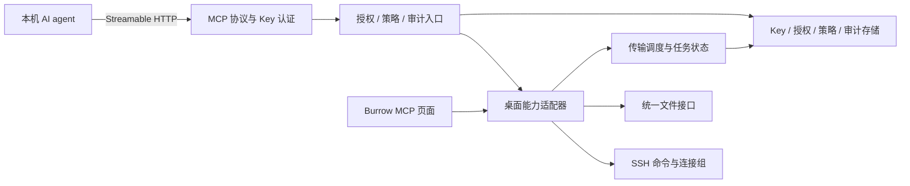

# MCP Server 功能方案

日期：2026-11-03。状态：本分支已接入 MCP 后端，页面布局、样式和组件保持原状，仅替换数据源及操作回调。认证、授权、策略、审计和任务身份统一写入现有 `burrow.db`。临时库 SQL 检查、官方 Go SDK 本机 HTTP 冒烟，以及 macOS 上真实 MCP → 原生桌面 → SSH/SFTP/FTP/显式及隐式 FTPS 的 30 项端到端场景已通过，包含服务启停、正常退出和强制崩溃后的人工恢复。Windows 当前仅完成构建检查；具体验证边界见第 14 节和 [MCP 联调说明](../dev/mcp-integration/README.md)。本文同时保留完整产品语义作为后续验收依据。

## 1. 目标与范围

Burrow 向本机 AI agent 暴露受控的 SSH 命令执行与 SFTP / FTP / FTPS 文件操作能力。用户在 Burrow 中管理可访问的连接、Secret Key、权限、拦截策略和审计，agent 使用已授权且未被策略拦截的能力完成检查服务器、读取配置、修改文件和上传下载等工作。

已确认的产品约定：

| 项目 | 约定 |
|---|---|
| 运行方式 | MCP Server 随 Burrow 应用运行，本机 agent 接入 |
| 页面入口 | 最左侧导航栏新增独立 MCP 页面，与 SSH、文件传输同级 |
| 接入认证 | 每次 HTTP 请求验证 Secret Key，未通过认证不得使用 MCP 能力 |
| 权限主体 | 以稳定的 `key_id` 关联连接授权、操作权限、任务和审计 |
| 拦截策略 | 独立管理 SSH 命令策略与文件操作策略；已获 Key 授权的操作仍受策略限制，任一拒绝命中即拦截 |
| 连接来源 | 第一版仅使用用户已保存并明确授权的连接 |
| SSH | 单次、无 PTY 的命令执行，使用独立于用户终端的连接组 |
| 文件操作 | 统一接口覆盖 SFTP、FTP、FTPS，复用现有文件协议与传输机制 |
| 审计 | 记录命令、文件路径、操作过程和结果；目录操作能够追溯到具体文件 |
| 后台任务 | 客户端断开不取消已接受的后台传输；撤销 Key 会阻止新调用并收敛其任务 |
| 数据归属 | MCP 客户端只能发现获准连接，默认只能查看和取消自己 Key 的任务 |

完整第一版包含独立页面、服务启停、Key 管理与授权、拦截策略、审计、只读文件工具、SSH 单次命令、文本写入、上传下载和任务管理。先交付读取能力用于打通接入链路，再交付执行与写入；这两个阶段共同组成第一版。

后续按需求扩展新建目录、重命名、移动、删除、长命令后台任务、交互式 Shell 和 stdio 桥接。文件策略预先定义这些操作类型，对应工具尚未上线时不显示为已可调用能力。第一版不包含远程公网或局域网接入、独立后台守护进程、动态创建任意目标连接、操纵现有终端输入、多用户管理平台或远端集中审计服务。

## 2. 使用流程

1. 用户进入 MCP 页面，开启服务，查看本机监听地址。
2. 新增 Secret Key，填写用途名称，选择获准连接、操作权限及本地上传来源和下载目录。
3. 按需新增 SSH 命令或文件操作拦截策略，选择适用连接、Key 与拒绝条件。
4. 用户复制新生成的 Key，并按接入模板配置 MCP 客户端。
5. 客户端携带 Key 发现工具和连接，按稳定的 `connection_id` 发起操作。
6. Burrow 验证身份、权限和参数，持久化操作开始记录，完成必要的路径核实与策略判断后执行获准动作；命中策略则记录拦截原因并返回。
7. 短操作直接返回结果；后台传输返回任务 ID，可查询进度或取消。
8. 用户在 MCP 页面按 Key、连接、操作类型、时间和结果查看审计，展开命中策略、目录操作的文件明细及关联任务。
9. 用户停用或撤销 Key 后，后续调用立即失效，相关排队和执行中任务按生命周期规则处理；历史审计保留。

查看 MCP 页面、切换页面和复制配置均不会隐式连接远端。密码、私钥口令、未知主机确认及交互认证继续由 Burrow 的用户交互处理，不把认证责任转交给 agent。

## 3. 独立 MCP 页面

### 导航与页面结构

最左侧导航栏在文件传输入口之后、底部设置入口之前增加 MCP 图标，复用现有 Rail、选中态、提示与键盘焦点约定。MCP 为独立业务页面，不放入设置页面，也不复用 SSH / 文件目录侧栏。

页面由顶部服务区和三个内容标签页组成，顺序为授权密钥、拦截策略、审计记录。界面中的 Secret Key 统一称为“授权密钥”。面向 designer agent 的完整功能与状态清单见 [MCP 页面设计功能清单](mcp-page-design-brief.md)。

| 区域 | 内容 |
|---|---|
| 服务区 | 服务开关、运行或故障状态、监听地址、复制客户端配置图标按钮、编辑 Host / Port 图标按钮，以及后端接入后的实际故障提示 |
| 授权密钥 | 名称、公开前缀或短 ID、状态、创建时间、最近使用时间、权限摘要；新增、编辑授权、停用、启用和撤销 |
| 拦截策略 | 按 SSH / 文件分类管理；名称、状态、适用连接与 Key、规则摘要；新增、编辑、启用、停用、命中审计和删除 |
| 审计记录 | 按 Key、连接、操作类型、时间和结果筛选，分页列表、命中策略及版本、操作详情、逐文件明细和关联任务 |

新增 Key 时显示完整密钥并提供主动复制入口，关闭后不再提供明文查看。接入模板使用 Key 占位符或目标客户端支持的环境变量引用，不为再次复制配置而持久化明文 Key。

授权密钥列表、审计列表和操作详情中的 Key 名称统一以纯文本展示，不附加头像或首字母徽标。

审计详情中可查看关联后台任务的实际进度和状态，并按当前状态提供取消、暂停或人工继续入口。任务无需打开文件标签即可创建、查询和管理。第一版不增加独立任务标签页。

策略编辑明确区分 Key 的“允许能力”与策略的“禁止操作”。文件规则逐行配置文件或目录路径、路径位置、是否包含子目录和禁止操作；重命名、移动、删除等尚未上线的工具能力在表单中标注“对应工具上线后生效”，不能误导用户以为当前已经支持执行。

新增与编辑策略使用公共模态框，策略列表保持全宽；长表单内部滚动，底部固定取消和保存按钮，校验失败保留输入，保存成功关闭弹窗。右侧详情抽屉用于审计与关联任务详情。

单击策略行只选中策略，不打开编辑；编辑仅通过策略菜单中的“编辑策略”进入，菜单可由右键或行尾“更多”按钮展开。

密钥菜单依次为“编辑密钥”“停用密钥”“撤销密钥”，已停用时使用“启用密钥”。策略菜单依次为“编辑策略”“停用策略”“命中审计”“删除策略”，已停用时使用“启用策略”。删除策略使用危险色及确认弹窗，删除后不再参与拦截；历史命中审计和规则快照保留。

三个主标签均展示计数，范围为 `0` 至 `99+`。审计列表与详情间的分隔条可左右拖动调整详情宽度。策略的适用连接与适用密钥直接使用标签式多选输入，留空表示全部并覆盖后续新增的匹配项，选择后仅适用所选项，标签尾部 X 可移除选择；所有下拉选中标记统一为行尾对勾。

页面复用 UIKit 与语义主题令牌，遵循明暗主题和现有交互。网络执行、服务监听、任务和数据库不能由页面挂载生命周期持有。

### 页面切换约束

当前应用存在“非设置页面即 SSH / 文件工作区”的判断。新增页面时必须显式限定目录帧、目录拖放、会话弹窗、侧栏调整、工作区布局与焦点恢复的适用页面，不能仅增加导航图标和枚举值。

MCP 页面切换不得影响现有终端、文件浏览和传输任务；离开 MCP 页面或隐藏窗口也不得停止 MCP 服务及后台任务。

## 4. 接入与协议

### 传输方式

第一版采用本机 Streamable HTTP，单一 MCP 路径为 `/mcp`，地址形如 `http://127.0.0.1:<port>/mcp`。服务初始关闭，用户开启后随应用运行；后续启动遵循已保存的启用状态，界面始终显示实际状态。

- 默认 Host 为 `127.0.0.1`，Port 为 `7801`，首次启动服务关闭。Host 与 Port 可在现有监听配置模态框中编辑；IPv4、IPv6 和主机名必须解析到本机回环地址，监听失败报告实际错误。
- 校验请求的 Origin 和目标主机，拒绝不合法来源，不以宽松 CORS 放开浏览器访问。
- 每次请求都验证 Key，不把 MCP 会话 ID、连接保持状态或客户端自报名称作为身份凭据。
- 端口占用或监听失败时报告实际错误，不显示已启动，也不静默换端口导致客户端配置失效。
- Key 只能通过认证请求头传递，不接受 URL 查询参数中的密钥。

```http
Authorization: Bearer <secretkey>
```

使用官方 MCP Go SDK `v1.8.0` 实现协议与工具注册，采用无会话状态的 Streamable HTTP 和 JSON 响应；身份始终来自每次请求的认证头。协议协商、编码和传输取消语义交给 SDK 处理。

本机预配置 Bearer Key 是本产品的首版认证方式，不将其描述为已经实现完整 OAuth 授权流程。首批接入客户端必须支持所选传输和认证头配置；远程接入与 OAuth 服务端另行设计。

### 身份与工具发现

认证前不返回保存连接、任务或工具执行数据。认证通过后，工具发现反映服务能力和该 Key 的权限；任何工具调用仍须再次执行服务端授权，工具是否出现在列表中不能替代权限检查。

agent 自报的名称与版本仅作为辅助信息，不得改变 `key_id`、权限或审计归属。建议每个 agent / client 使用独立 Key；多个客户端共享 Key 时，在授权与审计中属于同一身份，不能宣称能够可靠区分具体使用者。

## 5. Secret Key 管理

### 数据与生成

每个 Key 持有以下数据：

| 字段 | 含义 |
|---|---|
| `key_id` | 稳定、不可复用的公开身份 ID |
| `name` | 用户填写的用途名称，可以修改 |
| `secret_digest` | 用于校验的密钥摘要，不保存完整明文 |
| `display_prefix` | 展示和核对用的非秘密前缀或短 ID，不能用于认证 |
| `state` | `active`、`disabled` 或 `revoked` |
| `created_at` / `last_used_at` | 创建时间与最近通过认证的使用时间 |
| `grants` | 已授权连接、能力和本地目录范围 |

密钥由 Burrow 使用密码学随机源生成，秘密部分至少包含 256 位随机熵。首版不接受用户自定的低熵口令作为 Key。对于这种随机密钥，可保存 SHA-256 校验摘要；校验采用适当的恒定时间比较，公开索引不得单独构成认证。

完整密钥只在创建时展示。不得写入普通配置、调试日志、审计、错误信息或导出模板。丢失时新建 Key 并撤销旧 Key；不提供找回明文功能。

### 状态变更

- `active`：允许在授权范围内发起操作。
- `disabled`：暂时停用，可重新启用；停用期间不能认证或调用工具。
- `revoked`：永久撤销，不恢复原密钥；需要继续使用时新建 Key。

停用与撤销均立即阻止新请求，取消尚未执行的任务，并请求取消该 Key 的执行中操作。重新启用不会自动重启先前取消或暂停的任务。

Key 状态或授权缩减无法持久化时，立即阻止新的业务执行并关闭 MCP 服务，收敛受影响任务，同时明确提示变更尚未保存。不能把只在内存中生效的停用显示为永久撤销；存储恢复且状态核实前不得重新开放服务。

第一版通过撤销保留身份记录，不提供删除 Key 并连带删除审计的行为。历史操作保存当时的 Key 名称，同时保留稳定 ID，改名不改变历史归属。

新增、改名、启停、撤销和授权变更也记录为管理事件，来源标记为 Burrow 本地用户；不伪装成该 Key 发起的 agent 操作。

## 6. 授权模型

### 授权粒度

授权模型为“Key × 已保存连接 × 能力”，默认不授权任何连接和操作。拦截策略是授权之后的拒绝约束：最终允许执行必须同时满足 Key 授权、路径及协议能力要求，并且没有命中适用的启用策略；策略不能授予 Key 原本没有的权限。

| 能力 | 允许的操作 |
|---|---|
| `files.read` | 目录浏览、元数据查看、文本读取；下载还须满足本地下载目录授权 |
| `files.write` | 文本写入、上传；上传还须满足本地来源目录授权 |
| `ssh.exec` | 在指定 SSH 连接中执行一次命令 |

任务发现、查询和取消要求 Key 有效且任务归属于该 Key，不因为知道任务 ID 就取得访问权。Burrow 本地用户可以统一查看和管理全部 Key 的任务。第一版 MCP 不提供全局审计读取工具。

本地上传来源与下载目标分别显式授权，不默认开放整个本机文件系统，也不把远端文件权限等同于本地访问权限。采用现有固定目录句柄与受约束路径解析机制校验实际访问，不能只做字符串路径前缀判断。

远端边界以获准连接和远端账号权限为基础，叠加文件路径拦截策略。第一版不承诺用客户端目录前缀为 FTP / SFTP 建立可靠沙箱；递归传输继续遵循现有不跟随符号链接的规则。路径校验能力与无法判定时的处理见拦截策略章节。

`ssh.exec` 表示授予远端账号的命令执行能力，文件工具的目录规则不能限制任意命令，也不能通过命令关键词可靠判定“只读”。严格隔离依赖远端受限账号与系统权限。第一版不增加未经确认的逐命令审批机制；已有主机信任与凭据输入仍按既有流程处理。

### 连接与授权快照

`connection_id` 使用保存条目的稳定 ID，不使用列表下标、显示名称、地址匹配或当前打开标签的位置。SSH 目录与文件目录条目即使地址相同，也不自动共享授权。

授权需要绑定端点身份，包括协议、地址、端口、账号及适用的认证来源和跳板链。身份变化后暂停相应授权，用户重新确认前不允许新操作；仅改显示名称不改变身份。

每次接受操作时固定端点、跳板链、凭据版本、权限与归属快照。编辑目录不把已接受任务改向新地址；旧凭据不可用时按现有规则请求用户提供匹配凭据，不能把新密码发送给旧端点。

排队任务在实际启动前检查当前 Key 和相关授权是否仍有效。缩减权限、删除保存连接或移除本地目录授权后，阻止相应的新操作与排队任务，并请求收敛受影响的执行中操作；不影响该 Key 的其他无关授权。

### 请求处理顺序

1. 校验 HTTP 认证，确定服务端可信的 `key_id`。
2. 校验工具参数、连接类型、Key 权限和输出或执行限制，不在未授权时访问远端。
3. 在拥有应用状态的线程中捕获端点、归属和适用策略版本等不可变快照。
4. 分配 `operation_id`，必要时分配 `task_id`，持久化开始或排队记录。
5. 检查命令规则；文件操作在必要的受审计元数据核实后检查实际路径和动作，命中则记为“被策略拦截”。
6. 启动获准动作；需要用户输入时进入等待状态，受相应超时和取消约束。后台任务启动和每个实际文件阶段重新检查当前有效策略。
7. 更新审计与任务结果，返回结构化响应。

失败停留在哪一阶段，应能够从结果中区分。校验或授权拒绝不能触发远端业务动作；策略判定需要的最小路径或目标元数据查询应受审计，不得借校验读取文件正文、执行命令或写入数据。

## 7. 拦截策略

### 模型与作用范围

策略独立于 Key 管理，分为 SSH 命令策略和文件操作策略，均由 Burrow 本地用户配置。MCP 客户端不能创建、修改、停用策略，也不能通过请求参数跳过检查。

| 字段 | 含义 |
|---|---|
| `policy_id` / `version` | 稳定策略 ID 与已保存规则版本，供执行核对与历史审计使用 |
| `name` / `description` | 策略名称和用途说明 |
| `enabled` | 是否生效 |
| `category` | `ssh` 或 `files` |
| `connection_scope` / `connection_ids` | 全部或指定连接；界面留空表示当前分类全部连接（含后续新增），指定时保存稳定 ID |
| `key_scope` | 全部 Key，或显式选择的 Key ID；“全部”包括以后新建的 Key |
| `rules` | 命令匹配规则，或逐路径配置的文件禁止操作规则 |

一条策略可包含同一分类下的多条规则。保存命令策略时仅保留命令规则，保存文件策略时仅保留文件规则；列表摘要与数量只统计当前分类，已有混合数据在下次保存时清理非当前分类的规则。只评估与分类、连接和 Key 匹配的启用策略；任一适用规则命中即拒绝，保留全部命中原因。首版只提供拒绝规则，不提供允许覆盖拒绝或可调整优先级。

存储通过策略 JSON 中的 `AllConnections` 区分全部范围与指定 ID，不需要新增数据库表。已有策略未带该字段时仍按原指定连接执行，不会自动扩大范围；编辑表单清空连接选择再保存才改为全部范围。“全部连接”只适用于当前策略分类，实际执行仍先检查 Key 的连接与能力授权。

未命中策略不等于获得权限，仍须满足原有 Key 授权与本地目录范围。任务查询、停止服务和取消等收敛入口不作为 SSH 命令或文件操作进行策略拦截。

### SSH 命令策略

每条命令规则包含匹配方式与匹配内容，提供「精确匹配 / 正则匹配 / 模糊匹配」。精确匹配针对实际提交给远端的完整命令；模糊匹配为区分大小写的字面文本包含（存储模式 `contains`），不将输入当作通配符或正则；正则匹配按表达式判定。三种方式都只检查命令文本，不暗示会解析脚本或判断所有副作用。

规则在保存时校验，正则无效或匹配内容超限时报告对应字段错误，不发布不完整规则。匹配只决定是否拒绝，不执行命令进行试探，也不修改命令后再次发送。

命令文本策略用于防误操作，不能可靠识别 Shell 组合、脚本、解释器或远端程序的全部行为。允许任意 SSH 命令时，文件工具的路径策略也无法阻止该命令直接读写文件；严格隔离仍依靠远端账号与系统权限。第一版不引入语义安全判断或逐命令审批。

### 文件操作策略

每条文件规则配置路径位置（远端 / 本地）、文件或目录、规范路径、目录是否包含子目录，以及需要禁止的操作。远端规则作用于所选文件连接；本地规则作用于经这些连接上传或下载涉及的本地文件，不替代 Key 的本地目录授权，也不改变用户直接使用桌面文件页的行为。

| 禁止操作 | 语义与映射 |
|---|---|
| 浏览 | 列目录、查看条目元数据；与正文读取分开控制 |
| 读取 | 文件正文读取、下载的远端来源、上传的本地来源 |
| 创建 | 创建此前不存在的文件或目录，包括上传 / 下载的新目标 |
| 写入 | 修改、上传或下载覆盖已有文件，文本替换 |
| 重命名 | 同目录内改变文件或目录名称 |
| 移动 | 跨目录改变位置 |
| 删除 | 删除文件或目录 |

浏览与读取分开，可表达“允许看到条目但禁止读取正文”；创建与写入分开，可表达“允许新增但禁止覆盖”。这些是策略中的拒绝类型，不替代当前 `files.read` / `files.write` 等 Key 能力授权。

文件规则基于实际动作判定，不能只按工具名判断：上传 / 下载分别检查来源读取与目标创建或写入；文本创建与文本替换区分；尚未实现的重命名、移动、删除及独立新建目录工具在上线时接入对应类型。

### 路径、多步骤与递归操作

- 文件规则匹配目标本身；目录规则至少匹配目录本身，勾选包含子目录后匹配其整个子树。按路径组成部分判断边界，不能把 `/data/private-copy` 误认为 `/data/private` 的子目录。
- 规范化路径并按协议的实际文件名、编码与大小写语义处理，不随意转换远端大小写。检查符号链接或别名可能导致的真实访问位置；无法验证规则要求的边界时拒绝该访问并报告“无法校验路径”，不静默降级为字符串前缀判断。
- “浏览”拦截覆盖用户获得的目录与元数据结果；为执行策略所必需的内部最小元数据查询可在已授权及审计范围内进行，不向 agent 返回被禁止的元数据。
- 重命名和移动检查源、目标两侧对应动作，目标还须满足创建或覆盖限制；不能通过把受保护目标换名或移动到其中绕过规则。
- 移动实际通过复制再删除实现时，除移动规则外还检查读取、创建 / 写入和删除规则。跨协议移动不因定义策略类型就成为第一版工具。
- 递归任务逐项检查；目录重命名、移动或删除也须考虑受保护子项，不能只检查最外层路径。被拦条目不静默当作跳过，记录拒绝原因；已提交的其他条目保留，父任务显示失败或部分完成。
- `.part` 创建、最终提交与任务自有临时文件清理是原业务操作的内部阶段。按最终目标及原业务动作检查保护规则，不把上传中的内部 rename 误当成用户主动重命名；覆盖原目标仍受写入策略约束。取消清理仍严格限制于任务拥有的临时文件。

### 生效与运行中变更

已保存并启用的完整版本生效，编辑中的表单不改变执行规则。排队任务在启动前、文件任务在实际处理条目和提交前检查当前有效策略，同时保留接受任务时及实际判定时的版本，便于审计。

启用与停用使用独立状态更新，保持当前规则版本和内容不变，分别记录 `policy.enable` / `policy.disable` 管理事件；状态与审计同事务提交。编辑表单保存新策略内容继续递增规则版本。

新增、启用或收紧策略后，阻止新的匹配动作；受影响的执行中操作请求收敛，已经发生的远端效果不回滚。停用或放宽策略不自动重启被拦或已取消的任务。

策略读取失败不能作为“没有策略”处理。启用或收紧变更无法持久化时，按授权缩减失败的规则阻止新业务操作并关闭服务，明确提示未保存，核实存储与状态后才允许重新开启。

### 审计关联

被拦截是独立于 Key 权限不足和执行失败的结果，界面显示“被策略拦截”。记录操作、Key、连接、实际动作、命令或源 / 目标路径、全部命中的策略 ID、名称、版本、规则及原因，并保存判定时的规则快照。

策略新增、编辑、启用、停用和删除记录为本地管理事件。后续策略改名、编辑、停用或删除不改变历史命中解释；审计详情可以查看当时版本，不用当前规则替代历史快照。

## 8. 工具契约

### 第一版工具

| 工具 | 主要输入 | 主要返回与约束 |
|---|---|---|
| `connections_list` | 可选连接类型与分页参数 | 当前 Key 获准连接的 ID、名称、协议、必要端点信息和能力，不返回凭据 |
| `ssh_exec` | `connection_id`、`command`、可选超时 | `operation_id`、stdout、stderr、退出码及超时、取消、截断信息 |
| `files_list` | `connection_id`、远端路径、分页参数 | 条目元数据、分页或截断信息 |
| `files_stat` | `connection_id`、远端路径 | 条目类型、大小、时间、权限及可知的链接信息 |
| `files_read` | `connection_id`、远端路径、可选读取范围 | 有界文本、实际读取范围、是否截断 |
| `files_write` | `connection_id`、远端路径、文本、明确的创建或替换模式 | `operation_id`、实际提交结果 |
| `files_upload` | `connection_id`、本地来源、远端目标、冲突策略 | 接受后台任务后返回 `operation_id` 和 `task_id` |
| `files_download` | `connection_id`、远端来源、本地目标、冲突策略 | 接受后台任务后返回 `operation_id` 和 `task_id` |
| `tasks_list` | 状态和分页参数 | 仅列出该 Key 的任务，便于断线后找回任务 |
| `tasks_get` | `task_id` | 自有任务的状态、进度、逐文件汇总及结果 |
| `tasks_cancel` | `task_id` | 实际取消状态或“已请求取消”，不提前宣称已停止 |

`tasks_list` 用于解决异步任务已接受、但客户端在收到任务 ID 前断开的可达路径；它不提供跨 Key 的任务发现能力。

### SSH 命令

- 使用独立 channel、无 PTY，每次调用不继承上次调用的工作目录或 Shell 状态。
- 复用连接认证和跳板设置，不自动执行终端初始化命令，不向现有终端输入命令，也不继承其当前目录或临时环境。
- 命令字符串交由远端 SSH exec 语义处理，不通过本地 Shell 执行或拼接本地命令。
- stdout、stderr 和退出码分别返回；stderr 非空不等于执行失败。
- 命令被策略拦截、以非零状态退出、连接失败、超时、取消、输出超限和审计故障分别表达，不能只返回含糊的“执行失败”。
- 退出码不可知时返回空值和明确状态，不能补成 `0`。保留已经取得的有界输出，并说明是否截断。
- 第一版短命令同步返回，服务端设执行时间上限。长命令后台任务与交互式 Shell 留待后续。
- 超时或取消时关闭当前操作的 channel，不关闭用户终端连接；无法确认远端进程停止时将远端状态标记为未知。

### 文件读写与传输

- 文件名编码复用站点设置；文件内容不因文件名编码设置而自动转换。
- 文本接口第一版以 UTF-8 为明确契约，不静默替换无法解码的内容；二进制使用上传下载。
- 目录列表、文本读取、文本写入和错误返回均有大小上限，响应明确标记范围或截断，不伪装全量数据。
- 文本写入明确区分创建和替换。创建不能覆盖已有目标；替换必须由调用参数明确指定，复用现有暂存与最终提交机制。
- 所有实际动作进入文件策略检查。上传下载同时检查来源读取和目标创建 / 写入，目录任务逐项执行；规则不能只在入队时检查一次。
- 上传下载为异步任务；数据流经 Burrow 与目标，不把文件正文通过 MCP 结果回传给模型。
- 冲突策略由参数明确指定；未指定时遇到冲突报错，不静默覆盖，也不让任务无限等待未声明的重名弹窗。
- 复用现有 `.part` 所有权、源基线、摘要检查、权限保留和协议能力判断。服务器不支持必要能力时明确失败，不预先删除原目标。
- 目录任务允许已完成项与失败项并存，逐文件记录实际结果；整体不得把部分成功显示为全部成功。
- FTP 的条件重命名与跨客户端并发限制继续适用，不因 MCP 接口而承诺额外原子性。

### 结果与重试

工具以结构化数据返回操作 ID、状态和业务结果，使用稳定错误类别区分认证、授权、参数、策略拦截、路径无法校验、连接、执行、冲突、取消和审计失败。具体 MCP 错误封装遵循 SDK 与目标协议版本。

不自动重试命令、写入、提交或传输创建。网络中断可能发生在远端完成操作但响应未到达之后；此时保留未知状态，不重新执行来制造确定结果。

第一版不承诺跨网络与远端操作的 exactly-once 语义。客户端超时或丢失响应不代表操作未发生，应先查询自有任务或由用户检查审计；重复提交是新操作，不能隐式合并为“安全重试”。

## 9. 审计

### 记录范围与归属

所有 MCP 工具调用都进入统一审计入口，包括发现与查询、成功操作、权限拒绝、参数拒绝、策略拦截、连接失败和取消请求。任务状态与文件明细在实际执行点补充，不能只记录“工具被调用”。

认证成功的请求以服务端验证得到的 `key_id` 归属。无 Key、错误 Key 或已失效 Key 的认证失败进入独立安全事件，不保存提交的密钥或摘要；无法验证身份的请求不归到某个已知 Key。客户端自报信息不能用于冒充归属。

### 数据层次

| 层次 | 主要字段 |
|---|---|
| 操作 | `operation_id`、可选 `task_id`、`key_id`、当时的 Key 名称、工具、权限检查结果、创建与开始及结束时间、状态 |
| 端点快照 | 稳定连接 ID、当时名称、协议、主机、端口、账号、必要跳板身份，不含认证秘密 |
| 命令 | 命令原文、执行时限、可知的退出码、超时或取消及输出截断状态 |
| 文件明细 | 实际操作、源路径、目标路径、读取范围或传输字节、开始与结束时间、成功或失败及跳过结果 |
| 策略判定 | 命中的策略 ID、当时名称、版本、具体规则、判定原因与历史规则快照 |
| 生命周期事件 | 排队、等待用户、开始、暂停、继续、取消请求、终止、恢复和状态未知等转换及原因 |
| 管理与认证事件 | Key 管理、授权变更、策略管理、服务启停、认证失败、存储故障和审计清理 |

标识在持久化与重启后保持稳定，不使用可重编号的界面索引。目录上传下载中所有实际处理的文件及目录条目关联到同一操作和任务；仅被枚举、跳过和已经执行要区分。`files_list` 记录被浏览的目录和返回范围，不把列出的每个条目伪装成文件读取。

重命名等后续操作必须同时记录原路径和目标路径。写入的中间文件及清理行为作为关联明细或内部阶段记录，不伪装成新的 agent 请求。

### 写入顺序与失败处理

1. 开始远端访问或本地文件操作前，先持久化操作开始记录；后台任务接受前持久化排队记录及归属。
2. 目录任务执行具体文件操作前，先记录该条目的执行意图，完成后补充实际结果。不能等整个目录结束才一次性写入明细。
3. 操作完成后保存终态、退出码或传输汇总。Key 改名或客户端断开不改变过程记录的归属。
4. 开始记录无法持久化时不启动新操作，页面显示审计故障。终态记录失败时，操作可能已经发生，应暴露审计故障并阻止继续启动新业务操作；不能声称远端未执行，也不能重跑。
5. 对执行中的任务，在无法记录后续阶段时请求停稳，不继续处理尚未记录的文件；保留已取得结果与错误供用户处理，但不把内存结果当成已经持久化。
6. 重启发现只有开始记录或未完成的文件意图时，标记“中断 / 结果未知”；通过现有检查点能够核实的传输状态可继续核对，不直接补成成功。

审计故障不能阻止本地用户停止服务或请求取消任务；在服务尚可处理请求且 Key 状态可验证时，自有任务查询和取消也保留处理通道。对这些收敛操作说明审计未能落盘的事实；涉及 Key、授权缩减或策略收紧持久化失败时，关闭服务并明确报告未保存，不以审计故障为由让远端操作继续运行。

以上顺序提供可追溯的执行意图，不构成本地存储与远端服务器之间的分布式事务。进程崩溃、连接中断和远端响应丢失仍可能产生无法确认的结果。

### 敏感信息与保留

- 不保存认证请求头、Secret Key、Key 校验摘要、密码、私钥、私钥口令、文件正文或完整命令输出。
- 命令原文本身可能含敏感参数，无法保证自动识别全部秘密。审计按敏感本地数据保存，不能宣称能够可靠自动脱敏。
- 错误摘要采用错误类别与必要描述，不直接将包含 stdout / stderr 或凭据的底层错误字符串写入审计。
- 默认只允许 Burrow 本地用户浏览全局审计。MCP 客户端只获取自身调用结果与自有任务，不获得其他 Key 的路径或操作记录。
- 支持分页、按 Key / 连接 / 操作 / 时间 / 结果筛选，目录明细按需加载，不在页面挂载时全量读入。
- 提供明确的保留周期、容量阈值和本地清理入口。清理以已结束的操作和关联文件明细为单位，不清理活动任务、待核实状态或仍需恢复的记录。
- 第一版不默认后台删除历史；容量达到阈值时提示用户清理并阻止启动新业务操作，仍允许查询、取消和本地管理。
- 用户明确清理的范围和结果记为管理事件；清理 Key 或任务元数据不能连带静默删除审计。

这些是本机操作记录，不承诺对拥有本机数据修改权限的主体提供不可篡改证明。远端留存、签名链和合规审计另行设计。

## 10. 操作与任务生命周期

### 同步操作与后台任务

`operation_id` 标识一次工具调用，`task_id` 标识持续运行的后台任务。`tasks_get`、`tasks_cancel` 等调用有自己的操作记录，并关联被查询或控制的任务；不得用这些调用覆盖原始发起操作。

短命令、目录浏览、元数据和有界文本读写是同步操作，请求结束前返回结果。其 HTTP 请求取消按 SDK 语义传播到当前操作，已产生的远端效果无法回滚。

上传下载接受为后台任务后，生命周期独立于发起请求和页面。客户端断开、关闭连接或切换页面不会隐式取消这些任务；取消使用 `tasks_cancel` 或 Burrow 本地操作。

任务保留来源 `mcp`、发起 `key_id`、操作 ID、端点及凭据快照、冲突策略、接受时的拦截策略版本、传输清单、检查点和审计关联。执行时继续检查当前有效策略，不以旧快照绕过新增限制。MCP 任务不借用某个用户文件标签作为身份，不因标签关闭或工作区恢复开关而失去归属。

后台任务对外报告“已接受”前，除审计排队记录外，还须持久化可用于找回任务的最小元数据，包括任务 ID、归属、端点与凭据版本快照、源和目标路径以及冲突策略。当前仅在正常退出保存传输队列的机制不能单独满足这一契约，需要在接收任务时补充持久化；这不代表保证每个传输字节都有崩溃检查点。

### 状态与真实结果

任务至少能够表达：排队、等待用户、执行中、暂停、请求取消、已取消、成功、失败、被策略拦截、部分完成以及中断 / 结果未知。具体枚举可适配现有传输引擎，但展示与 MCP 返回不得丢失这些语义；部分完成的任务可以同时包含被拦的文件明细。

| 事件 | 约定 |
|---|---|
| 切换页面 / 隐藏窗口 | 服务和任务继续 |
| 客户端断开 | 已接受后台任务继续；同步调用传播请求取消 |
| 显式取消 | 先进入请求取消，worker 和 I/O 停稳并核实后才返回最终状态 |
| Key 停用 / 撤销 | 拒绝新请求，取消排队任务，请求取消该 Key 的执行中操作 |
| 权限缩减 / 连接删除 | 阻止新的相关操作，收敛受影响任务，其他授权不受影响 |
| 策略新增 / 启用 / 收紧 | 新动作和排队任务使用当前规则，阻止匹配动作，收敛受影响执行；记录实际命中版本 |
| 策略停用 / 放宽 | 不自动重启被拦、暂停或取消的任务 |
| 关闭 MCP 服务 | 停止接收新操作；收敛同步请求，暂停可恢复的后台传输并保存状态 |
| 再次开启服务 | 不自动继续先前暂停、取消或状态未知的任务 |
| 正常退出应用 | 先停止接入，再让 worker 停稳，保存传输检查点与可保存的审计，最后释放连接 |
| 强制退出 / 崩溃 | 重启后核对已有记录；未确认完成的操作标记中断或未知，不自动执行 |

取消传输沿用现有规则：只清理任务拥有的部分文件，已经提交的文件保留；清理失败明确报告，不能显示“全部撤销”。目录部分完成时保留每个条目的结果。

取消命令或关闭 channel 不保证远端后台进程已经终止。响应与审计分别表达本地处理结果和可确认的远端状态，不将“取消请求已发出”等同于“远端已停止”。

### 重启与人工恢复

恢复 MCP 任务不依赖文件标签或工作区自动恢复设置。持久化记录加载后保持离线与暂停 / 中断状态，不自动登录或继续。

人工继续传输前确认原 Key 仍有效、授权和本地目录仍允许、当前策略允许继续、端点与凭据快照可用，再复用现有源基线、摘要、暂存文件及提交状态校验。Key 已撤销或任务归属无法确定时不猜测替换身份，也不静默迁移到新 Key。

第一版由 Burrow 本地用户发起暂停后继续；MCP 仅提供任务发现、查询和取消，不增加 `tasks_resume`。命令执行在重启后不自动重放。

## 11. 实现结构与复用边界



建议新增薄的 `internal/mcpserver` 包，负责 SDK 集成、认证、工具 schema、调用映射和结构化结果。由桌面适配器提供已授权连接及策略快照、用户认证交互、执行与任务入口；共用策略判定入口，执行点补充实际动作与路径核实，不能只在界面或工具描述中约束。仅抽取 UI 与 MCP 确实需要共用的业务逻辑，不建立完整的新业务框架或另一套文件传输引擎。

| 当前位置 | 现状与实现工作 |
|---|---|
| [app.go](../internal/desktop/app.go) | 增加页面注册与内容分发，收窄仅适用于 SSH / 文件页的判断；接入应用级服务启停和退出 |
| [ssh_sessions.go](../internal/desktop/ssh_sessions.go) | 连接组与请求调度由窗口线程持有；为 MCP 提供独立连接组与受控适配入口 |
| [ssh_runtime_config.go](../internal/desktop/ssh_runtime_config.go) | 复用端点与跳板快照、凭据获取和主机信任；不能从 HTTP worker 直接读写目录状态 |
| [session_store.go](../internal/desktop/session_store.go) | 复用稳定连接 ID、凭据版本及托管密钥规则，不向 MCP 暴露秘密 |
| [exec.go](../internal/sshclient/exec.go) | 为 agent 返回独立 stdout、stderr、实际退出码与截断状态；原内部固定命令接口保持既有语义 |
| [client.go](../internal/fileclient/client.go) | 复用统一文件接口及可选协议能力，不为每种协议设计独立工具集 |
| [file_connections.go](../internal/desktop/file_connections.go) | 复用连接配置、认证与子系统创建，分离对文件标签和窗口线程的直接依赖 |
| [transfer_backend.go](../internal/desktop/transfer_backend.go) | 复用传输清单、锁、暂存、摘要、提交与清理，在真实执行点补充策略检查和审计，区分用户动作与内部阶段 |
| [ftp_transfers.go](../internal/desktop/ftp_transfers.go) | 增加 MCP 来源和 Key 归属，任务展示不以文件标签存在为前提 |
| [transfer_store.go](../internal/desktop/transfer_store.go) | 扩展任务身份和检查点持久化，保留旧文件任务的读取与恢复语义 |

连接复用边界：MCP 可以在同一 Key、同一端点快照内复用合适的 SSH transport，但不与用户终端或其他 Key 共享可被整体取消的连接所有权。不同文件消费者继续使用独立 FTP 控制连接或 SFTP 子系统，单次取消不影响兄弟业务。

线程与上下文边界：应用目录、页面状态和现有队列按当前窗口线程约定访问；worker 只消费不可变快照。应用、服务、同步调用、后台任务和协议 channel 的上下文分别持有，不把后台任务绑定到一次 HTTP 请求，也不在 UI 线程等待网络或审计落盘。

服务关闭顺序必须先阻止新请求，再等待或取消相关 worker，完成任务与存储收敛，最后关闭监听和存储；不能先关闭数据库再让完成回调写入审计。

## 12. 持久化与运行限制

### 数据布局

MCP 复用应用路径接口和现有 `internal/store`，全部结构化数据保存在当前用户数据目录的 `burrow.db`。schema v1→v2 在同一事务升级；密码、私钥口令与文件正文仍保持原有存储边界。

| 数据 | 已接入的位置与职责 |
|---|---|
| 服务配置 | 原有 `settings` 表的 `mcp` 条目；配置和管理审计同事务提交 |
| Key、授权、策略 | `mcp_keys`、`mcp_policies`；只保存校验摘要、授权范围和已发布的完整策略 |
| 操作与文件审计 | `mcp_operations`、`mcp_files`；保留命中时的规则快照、原始逐文件事件与生命周期，详情以每个路径最新事件汇总 |
| 任务身份与检查点 | `mcp_tasks` 与原有 `transfer_*`；沿用原任务 ID，队列清单与 Key / 操作归属在接受前同事务提交 |

驱动继续使用项目现有的 `database/sql + modernc.org/sqlite`、单数据库连接、WAL 与 FULL 同步设置。操作开始记录在远端业务 I/O 前落盘，密钥和策略变更与本地管理审计同事务提交。应用重启把未完成操作标为中断，恢复任务保持离线并等待人工继续。

Key 校验摘要不能代替远端凭据。SSH / FTP 密码与私钥口令继续走系统凭据接口，不复制进 MCP 配置或数据库。

审计与传输检查点共用同一个数据库，但只有明确放进同一个事务的变更才具有原子性；网络执行、文件系统和系统凭据仍在数据库事务之外。清理历史会保留活动、中断、暂停及仍有可恢复队列清单的操作。

配置读取失败保留原数据并阻止覆盖，存储故障时不默默创建空库继续执行。任务格式扩展必须保留已有 UI 文件任务的恢复能力，不能把旧标签任务自动认领为某个 Key 的任务。

### 有界运行

实现必须为以下入口确定有限值，并在错误或响应中说明达到限制的情况：

- HTTP 请求体、命令字符串、文本读写与工具结果大小。
- 命令执行、连接建立、等待用户输入和服务关闭时间。
- stdout / stderr 缓冲、目录返回条数及分页大小。
- 每个 Key 与服务整体的并发操作、排队任务数量；上传下载继续遵守现有全局传输并发设置。
- 策略数量、每条策略的规则数、命令匹配与路径表达式长度及策略查询批量大小。
- 审计事件大小、单次查询和文件明细加载条数、总容量与保留周期。

参数不为零无限制，也不因客户端请求更大的值而突破服务端上限。输出被截断、执行因超限中止和目录列表不完整必须分别说明；因输出超限关闭 channel 后，不伪造已知退出码或远端停止结论。

当前固定值：HTTP 请求体最多 2 MiB，命令最多 64 KiB，文本写入最多 1 MiB；文本读取默认 64 KiB、最多 1 MiB；命令默认 60 秒、最多 120 秒，同步工具整体最多 2 分钟。stdout 最多 1 MiB、stderr 最多 64 KiB。全服务同时处理最多 8 个工具调用，传输队列上限 1000 项并继续遵守原传输并发设置；单目录最多枚举 10000 项、单任务最多枚举 100000 项。每条策略最多 100 条规则，正则最多 8192 字节，单页返回最多 1000 条。

现有详情抽屉一次加载最多 1000 个路径的最新汇总，计数来自完整结果；完整原始事件仍可通过存储层分页查询。本次不增加新的页面或明细分页控件。

SFTP 路径规则使用 REALPATH 解析实际目录，本地传输以授权根目录句柄限制访问。FTP/FTPS 的 PWD 不能证明实际文件位置；当适用的禁止动作需要验证物理路径时，返回 `path_unverifiable`，不退回字符串前缀判断。这些拦截规则仍不替代远端账号与操作系统权限。

以下细节在实现前或首批客户端联调时定值并回写本文，不改变已确认的权限、审计和生命周期语义：

| 待确定项 | 确认依据 |
|---|---|
| 首批接入客户端 | 至少选定一个实际使用的客户端，验证本机 HTTP、认证头和工具结果展示 |
| 默认监听端口 | 已固定为 7801，可通过现有配置弹窗修改；占用明确报错 |
| SDK 固定版本 | 已固定官方 Go SDK v1.8.0，本机 SDK 客户端验证通过 |
| 存储驱动及 schema | 复用 modernc SQLite，schema v2，保留 v1 数据原地升级 |
| 运行限制数值 | 已按上述值设定，真实服务器规模与性能仍需联调 |
| 审计保留周期与容量阈值 | 实际目录任务规模和用户可管理的本地存储；默认不自动删除历史 |

## 13. 分阶段实施

### 阶段一：页面、认证授权、策略、审计与读取

- 独立 MCP 页面和应用级服务启停。
- Key 生成、一次性展示、摘要校验、管理和连接授权。
- 拦截策略标签页、公共模型和版本管理，SSH / 文件规则编辑及校验；读取链路中的浏览和读取拦截先行生效。
- 审计存储、管理事件、故障处理、筛选分页与操作详情。
- `connections_list`、`files_list`、`files_stat`、`files_read`。
- 首批客户端完成真实接入，验证跨 Key 隔离、停用或撤销以及切页与隐藏窗口行为。

退出条件：本机 agent 可以使用指定 Key 读取获准且未被策略禁止的文件，全部调用能够按 Key 追溯；越权、认证失败和策略拦截有明确结果，审计不可写时不会启动新读取操作。尚未上线的命令与写入工具不因策略表单存在而被宣称已可执行。

### 阶段二：完成第一版执行、写入与任务

- 结构化 `ssh_exec`，独立连接组、时限和输出限制。
- `files_write`、上传下载，复用现有提交和恢复机制。
- 命令匹配拦截，以及上传下载、文本创建与覆盖的逐动作文件拦截。
- `tasks_list`、`tasks_get`、`tasks_cancel` 与跨 Key 访问控制。
- 逐文件审计、后台任务展示、断线继续、撤销取消、服务停用与应用退出收敛。
- MCP 任务独立于文件标签恢复，离线加载与人工继续。

退出条件：agent 可以在授权和策略范围内读取配置、上传文件并执行检查命令，获得准确的结果；任务可找回、可追溯、可取消，规则在实际执行点生效，且不会干扰用户终端或其他 Key 的任务。

### 后续扩展

在第一版验收后，再按明确需求加入新建目录、重命名、移动、删除、长命令异步任务、交互式 Shell 和 stdio 桥接。任何新增工具都必须接入同一身份、授权、策略、审计与任务机制。

删除和递归删除需要单独明确权限与逐文件结果，不能仅因 Key 已有文本写入权限就默认授予。远程接入、独立守护进程及集中或防篡改审计属于新的产品范围。

## 14. 验收场景

下表是完整产品的验收要求，不能将每一行都视为已经通过。当前已验证范围见本节完成记录；真实联调复用本机协议夹具，不涉及用户私有服务器、真实数据目录或视觉验收。

| 场景 | 必须观察到的结果 |
|---|---|
| 无 Key、错误 Key、停用或撤销的 Key | 不能取得工具业务数据、连接或任务；认证失败事件不包含提交的秘密 |
| 两个 Key 授权不同连接 | 连接发现和实际操作均隔离，伪造客户端名称不能改变权限 |
| 只读 Key 发起写入或命令 | 明确拒绝，远端与本地目标没有操作副作用，拒绝记录可追溯 |
| Key 有权限但命中启用策略 | 被策略拦截，不能由其他未命中策略或请求参数放行；审计保留全部命中规则与版本 |
| 策略仅适用于指定连接或 Key | 仅约束所选范围；“全部 Key”包含后续新建的 Key |
| SSH 精确匹配、正则匹配、模糊匹配与无效正则 | 按声明语义拦截；模糊匹配按区分大小写的字面包含判定；无效规则不保存为生效版本，不用命令试执行验证 |
| 禁止读取但允许浏览 / 禁止写入但允许创建 | 返回与真实动作一致；能看到条目不等于能读取，不能用上传或文本替换绕过写入禁止 |
| 文件与目录边界、子目录和链接路径 | 不发生简单前缀误匹配；不能核实边界时明确拒绝，不声称已可靠隔离 |
| 后续重命名、移动或删除工具上线 | 源与目标、受保护子项及实际复制 / 删除动作全部接入对应检查 |
| 上传中的内部暂存与提交 | 按用户实际创建 / 写入语义检查，不因内部 rename 被误当成用户重命名 |
| 排队或执行期间收紧策略 | 后续动作使用当前规则，受影响操作请求收敛；放宽后不自动重启 |
| 已命中策略后来改名、编辑或停用 | 历史审计仍显示当时的策略名称、规则与版本 |
| 跨 Key 查询或取消任务 | 被拒绝，知道任务 ID 不产生权限 |
| 修改连接地址、账号或跳板身份 | 新操作等待重新授权，已接受任务不改向新端点 |
| 上传来源或下载目标越过本地授权目录 | 被拒绝；不能利用路径解析绕过实际目录边界 |
| SSH 退出码为 0 且有 stderr | stdout、stderr 分开返回，不能只因 stderr 非空报告命令失败 |
| 命令非零退出、超时、取消或输出超限 | 状态、退出码可知性和截断信息准确，不自动重跑 |
| agent 执行期间操作用户终端 | 独立运行；agent 取消不关闭用户终端连接或注入终端输入 |
| 读取、写入、上传下载 | 命令或路径、范围、任务、Key 与实际结果对应，不保存正文或凭据 |
| 目录包含成功、失败和跳过条目 | 汇总与逐文件明细一致，可以确认实际处理过哪些文件 |
| 客户端在收到任务 ID 前断开 | 已接受任务有持久归属，可通过自有任务列表或 Burrow 找回，不隐式重建任务 |
| 已接受后台传输后客户端断开 | 任务继续，切页或隐藏窗口也不改变归属与执行 |
| 排队与运行期间撤销 Key | 新调用立即失效，排队任务取消，运行任务请求收敛并记录实际结果 |
| 取消目录传输或清理失败 | 已提交文件保留，部分完成与清理错误可见，不宣称全部回滚 |
| 执行前审计存储失败 | 不启动新业务操作，页面报告故障，停止和取消仍可用 |
| 操作已发生而终态审计写入失败 | 区分操作结果和审计故障，不自动重试，不虚构持久化成功 |
| Key 撤销、授权缩减或策略收紧无法持久化 | 关闭服务并提示未保存，不把内存中的状态显示为已永久生效 |
| 正常关闭服务或退出应用 | 无新操作进入，相关 worker 停稳，检查点与审计按顺序收敛 |
| 崩溃后重启 | 未完成记录为中断或未知，任务离线恢复，不自动执行命令或继续传输 |
| Key 改名、撤销与历史清理 | 历史身份可追溯，清理范围明确，活动与待恢复记录不被删除 |
| 审计包含敏感命令参数 | 界面如实说明本地敏感数据边界，不承诺已自动识别全部秘密 |

每个实施阶段交付时分别报告已修改、已运行和已验证的范围。阶段一读取通过不能代表完整第一版完成；协议夹具通过也不能替代实际 MCP 客户端接入验证。

### 2026-11-03 完成记录

在全新隔离配置下，使用真实 MCP HTTP 客户端、带 `-race` 的原生 macOS 应用、生产连接适配器与传输队列，连续通过 30 项场景。协议文件与最终传输内容由 Docker 服务端独立读取并核对 SHA-256；正常退出、重启、强制终止及再次重启分别启动同一测试构建，四阶段日志无竞态报告。运行入口、覆盖清单和本地报告位置见 [联调记录](../dev/mcp-integration/README.md)。

本轮修复了真实路径发现的问题：超时的错误分类在审计与响应中保持一致；同步调用传播新旧协议的 HTTP 取消，已接受的后台传输继续独立运行；文件读取完成前重新校验当前授权和策略；取消上传的远端清理不再依赖仍可打开本地来源；任务继续时同步更新操作状态。FTP 覆盖受限目标使用经核实的 `0700` 私有暂存目录，并保存、校验目录与内容的任务归属，支持退出恢复和只清理自有暂存。

测试中 `EPSV` 的 `500` 已经独立复现为夹具 5 个被动端口耗尽：第 6 个连接绑定失败并触发 vsftpd 内部 IPC 错误。夹具统一扩为 64 个端口，16 个同时监听回归通过；未给生产 FTP 增加重试，也未关闭证书或路径安全检查。

本轮没有验证所有第三方 AI 客户端界面、Windows 原生运行、真实系统钥匙串交互、所有服务器品牌与生产规模，也不将协议测试等同于上表全部边界已验收。FTPS 使用仅测试 overlay 注入的临时 CA；不更改系统证书信任。FTP/FTPS 无法证明策略要求的物理路径时仍拒绝访问；详情一次加载 1000 个路径的既有限制保持不变。

## 15. 关联资料

- [MCP 页面设计功能清单](mcp-page-design-brief.md)：交给 designer agent 的完整页面、表单、详情和状态清单。
- [架构与生命周期](architecture.md)：当前连接、任务和窗口线程约定。
- [文件管理与传输](file-transfer.md)：当前提交、暂停、继续、取消和恢复语义。
- [数据与凭据](storage.md)：当前应用数据目录、凭据版本与主机信任规则。
- [开发与构建](development.md)及[联调与原生 E2E](../dev/ssh-integration/README.md)：现有检查与本机协议夹具。
- [MCP Go SDK](https://github.com/modelcontextprotocol/go-sdk)：官方 SDK 与协议兼容说明。
- [MCP Streamable HTTP](https://modelcontextprotocol.io/specification/2026-07-28/basic/transports/streamable-http)：传输、Origin 和本机监听要求。
- [MCP Authorization](https://modelcontextprotocol.io/specification/2026-07-28/basic/authorization)：HTTP 授权规范与适用范围。
- [MCP Tools](https://modelcontextprotocol.io/specification/2026-07-28/server/tools)：工具发现、输入与输出契约。

实现落地后同步更新对应的当前使用、架构和存储文档，并在本文记录真实完成与验证范围。不要仅通过修改方案状态宣称功能已实现。
